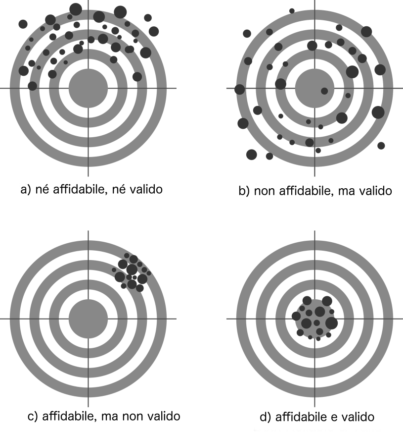

## {.plain}

```{=latex}
\nftitleslideauthors{Giorgio Arcara, Sara Lago}{3a · Affidabilità (teoria)}
```

## Validità e affidabilità (brevi definizioni)

La **validità** è la qualità di un test di misurare effettivamente il costrutto che vuole misurare.

L’ **affidabilità** indica la precisione di un test.

# Affidabilità

## Affidabilità/precisione

L'**Affidabilità** è la qualità di un test di fornire punteggi consistenti in diverse misurazioni: può essere intesa come la **precisione** di un test.

Come per la validità, gli _Standards_ (AERA, APA, & NCME, 2014) trattano l'affidabilità come un **principio unitario** — l'ombrello "affidabilità/precisione" — di cui i "tipi" che seguono sono sfaccettature diverse, non categorie separate.

## Tipi Affidabilità

- Affidabilità inter-rater
- Affidabilità test-retest
- Affidabilità split-half
- Consistenza Interna


Esistono diverse classificazioni di affidabilità. Questa che sto utilizzando è una delle possibili.

## Valori desiderabili

Spesso le misure di affidabilità sono associate a numeri. Le slide seguenti ipotizzerò dei valori desiderabili di affidabilità che un test dovrebbe avere.

È importante che questi sono valori "indicativi" e non esistono reali valori considerati come standard nella letteratura. Per tale ragione spesso circolano test con valori ben più bassi di quelli desiderabili.

## Inter-rater agreement 1/2

**Inter-rater agreement** (affidabilità inter-rater): è una misura della consistenza con cui diversi esaminatori valutano la stessa prestazione dello stesso paziente.

## Attività (Wooclap)

```{=latex}
\wooclapslot{Domanda}{Secondo te, quali fattori riguardanti un test possono influenzare il suo inter-rater agreement?}{Andate su \href{https://www.wooclap.com}{\underline{wooclap.com}} e inserite il codice \textbf{SOZZBAQ}, oppure inquadrate il QR code.}{}{Figures/wooclap_qr_code_SOZZBAQ.png}{SOZZBAQ}
```

## Inter-rater agreement 2/2

È legata alla chiarezza delle istruzioni su come attribuire i punteggi e alla complessità dei comportamenti osservati nel test — ed è collegata al concetto di **oggettività** del test (vedi Cornice teorica).

Esistono vari modi di calcolarla. Nel metodo più diffuso è espressa da un coefficiente, l'intraclass correlation (ICC) — una **famiglia** di coefficienti — che varia tra 0 e 1, dove 0 indica completa inconsistenza tra i punteggi e 1 indica assoluta consistenza tra i punteggi di due o più esaminatori.

Valori maggiori a 0.60 sono desiderabili (Cicchetti & Sparrow, 1981; Fastenau et al., 1996).

## Affidabilità test-retest 1/8

**Affidabilità test-retest**: la consistenza dei punteggi ottenuti dalle stesse persone in due occasioni diverse, assumendo che non ci sia stato un cambiamento _reale_ nel costrutto misurato e che le condizioni di somministrazione siano comparabili.

In genere è espressa da un coefficiente di correlazione che varia tra -1 e 1, ma può essere anche espressa dal coefficiente ICC (lo stesso usato per Inter-rater agreement).

valori maggiori a 0.70 sono desiderabili

## Affidabilità test-retest 2/8

Nota che l’affidabilità test-retest è sempre valutate con uno specifico intervallo (es. 1 mese). Per tale ragioni esistono infinite possibili affidabilità test-retest, dal momento che questo valore potrebbe variare a seconda dell’intervallo.

Generalmente, più corto è l’intervallo, più è probabile sia alta l’affidabilità test-retest.

## Affidabilità test-retest 3/8


```{=latex}
\begin{columns}
\column{0.8\textwidth}
\small
\textbf{Se misurata con correlazione, l'affidabilità test-retest \textbf{non indica la stabilità del punteggio dei test nel tempo, o la possibilità di usarlo per fare valutazioni nel tempo.}} 

\column{0.2\textwidth}
\begin{figure}
\includegraphics[scale=0.05]{Figures/triangle.png}
\end{figure}
\end{columns}
```

La correlazione cattura infatti solo la **consistenza relativa** (l'ordine relativo delle persone si mantiene), non un accordo assoluto sui valori — per questo va sempre affiancata da un'analisi dei cambiamenti sistematici (es. confronto delle medie; vedi Arcara \& Bambini, 2016).

## Affidabilità test-retest 4/8

Se ripeto la valutazione con lo stesso test alla stessa persona a distanza di un tempo x, posso essere ragionevolmente sicura che il punteggio al test rifletta le sue reali abilità cognitive, e sia influenzato solo in misura trascurabile dalle circostanze della somministrazione.

## Affidabilità test-retest 5/8

La teoria classica dei test postula che il punteggio osservato sia composto da punteggio vero + errore.

\begin{center}
$X = T + E$
\end{center}

$X$ = punteggio osservato

$T$ = punteggio vero

$E$ = errore

\vspace{1em}

L'affidabilità test-retest cerca di quantificare l'errore legato a misurazioni ripetute di un test.

## Esempio: confronto tra test con alta vs bassa affidabilità test-retest

```{=latex}
\begin{columns}[T]
\column{0.48\textwidth}\centering
\includegraphics[height=0.58\textheight]{Figures/test_retest_alta_vs_bassa_a.png}
\column{0.48\textwidth}\centering
\includegraphics[height=0.58\textheight]{Figures/test_retest_alta_vs_bassa_b.png}
\end{columns}
\vspace{6pt}
\centering\textbf{Qual è la differenza tra i due grafici? Quale dei due corrisponde ad alta affidabilità test-retest e perché?}
```

## Affidabilità test-retest 6/8

Quando è usata la correlazione come misura, i punteggi potrebbero avere un'affidabilità test-retest (correlazione) di 0.98, ma essere poco stabili perché soggetti a _variazioni sistematiche_.

\pause
**Problema**: l'affidabilità test retest calcolata con correlazione non tiene conto delle **variazioni sistematiche** nella performance, cioè quei **cambiamenti non casuali** tra i punteggi al test e al retest che si verificano per ogni individuo: l'effetto pratica e regressione verso la media. Il cambiamento esiste, ma questa concettualizzazione dell'affidabilità test retest non la prevede!


## Affidabilità test-retest 7/8

La teoria classica dei test postula che il punteggio osservato sia composto da punteggio vero + errore.

\begin{center}
$X = T + E$
\end{center}

$X$ = punteggio osservato

$T$ = punteggio vero

$E$ = errore

\vspace{1em}

L'affidabilità test-retest cerca di quantificare l'errore legato a misurazioni ripetute di un test.

Esistono diverse fonti di errore: casuale e sistematico. In questo caso stiamo cercando di quantificare l'errore **casuale** (dovuto a circostanze legate alla somministrazione).

## Affidabilità test-retest 8/8

Visto che questa definizione non tiene conto dei cambiamenti sistematici, oltre a considerare il valore di affidabilità test-retest bisognerebbe sempre affiancare anche un'analisi di differenza delle medie (t-test o altri metodi, es. APACS; Arcara & Bambini, 2016) per verificare che i punteggi al test e al retest siano (o meno) effettivamente diversi.

## Domanda

```{=latex}
\vfill
\begin{center}
{\LARGE\bfseries Esistono casi nei quali è necessario capire se la performance cognitiva di una persona è cambiata nel tempo?\par}
\vspace{1.2em}
{\LARGE\bfseries Come fareste a valutare il cambiamento?\par}
\end{center}
\vfill
```

## Esempio

AD è una donna di 63 anni che soffre di morbo di Parkinson. Per mitigare i sintomi motori, le viene proposto un intervento per installare un dispositivo DBS. Prima di sottoporsi all'intervento, svolge una valutazione neuropsicologica di routine per monitorare i sintomi cognitivi.

Un mese dopo l'intervento, i familiari di AD notano un repentino peggioramento delle sue abilità cognitive. Sono convinti che questo dipenda dall'intervento e non dal normale progredire della malattia, e vogliono intentare una causa per danni. Pertanto, incaricano un consulente di parte di dimostrarlo. Basandosi sull'ultima valutazione, il consulente ne effettua un'altra usando gli stessi test.

Di seguito i punteggi.

## Esempio: punteggi di AD 1/2

```{=latex}
\begin{center}
\tiny\setlength{\tabcolsep}{2.5pt}\renewcommand{\arraystretch}{1.05}
\begin{tabular}{>{\raggedright\arraybackslash}p{1.85cm} >{\raggedright\arraybackslash}p{2.95cm} >{\centering\arraybackslash}p{1.15cm} >{\centering\arraybackslash}p{1.15cm} >{\centering\arraybackslash}p{0.75cm} >{\centering\arraybackslash}p{0.85cm} >{\centering\arraybackslash}p{1.45cm} >{\centering\arraybackslash}p{1.12cm} >{\centering\arraybackslash}p{1.12cm} >{\centering\arraybackslash}p{1.0cm}}
\toprule
\textbf{Dominio} & \textbf{Test} & \textbf{Prima valutazione: grezzo (corretto)} & \textbf{Seconda valutazione: grezzo (corretto)} & \textbf{Cut-off} & \textbf{Punteggio massimo} & \textbf{Soglie cambiamento significativo (solo APACS)} & \textbf{Prima valutazione (\%)} & \textbf{Seconda valutazione (\%)} & \textbf{Differenza \% (seconda $-$ prima)} \\
\midrule
Pragmatica & APACS interview & 34\textsuperscript{*} & 31\textsuperscript{*} & 42 & 44 & No thresholds available & 77.27 & 70.45 & $-$6.82 \\
 & APACS description & 46 & 41\textsuperscript{*}\textsuperscript{°} & 45 & 48 & 44---no upper threshold & 95.83 & 85.42 & $-$10.42 \\
 & APACS narratives & 47 & 39\textsuperscript{*}\textsuperscript{°} & 47 & 56 & 52---no upper threshold & 83.93 & 69.64 & $-$14.29 \\
 & APACS figurative language 1 & 14 & 14\textsuperscript{°} & 13 & 15 & 14---no upper threshold & 93.33 & 93.33 & 0 \\
 & APACS humor & 5 & 7\textsuperscript{°} & 4 & 7 & 5--6 & 71.43 & 100 & +28.57 \\
 & APACS figurative language 2 & 13\textsuperscript{*} & 10\textsuperscript{*} & 21 &  & No thresholds available & 43.33 & 33.33 & $-$10 \\
 & APACS pragmatic comprehension composite & 0.73\textsuperscript{*} & 0.74\textsuperscript{*} & 0.78 & 1 & 0.72--0.84 & 73 & 74 & +1 \\
 & APACS pragmatic production composite & 0.87\textsuperscript{*} & 0.78\textsuperscript{*}\textsuperscript{°} & 0.95 & 1 & 0.87--0.92 & 87 & 78 & $-$9 \\
 & APACS total composite & 0.8\textsuperscript{*} & 0.76\textsuperscript{*}\textsuperscript{°} & 0.88 & 1 & 0.82--0.88 & 80 & 76 & $-$4 \\
\bottomrule
\end{tabular}
\end{center}
\vspace{-0.8em}
{\tiny \textsuperscript{*} = performance deficitaria; \textsuperscript{°} = cambiamento significativo. Adattata da Lago et al. (2022).\par}
```

## Esempio: punteggi di AD 2/2

```{=latex}
\begin{center}
\tiny\setlength{\tabcolsep}{2.5pt}\renewcommand{\arraystretch}{1.05}
\begin{tabular}{>{\raggedright\arraybackslash}p{1.85cm} >{\raggedright\arraybackslash}p{2.95cm} >{\centering\arraybackslash}p{1.15cm} >{\centering\arraybackslash}p{1.15cm} >{\centering\arraybackslash}p{0.75cm} >{\centering\arraybackslash}p{0.85cm} >{\centering\arraybackslash}p{1.45cm} >{\centering\arraybackslash}p{1.12cm} >{\centering\arraybackslash}p{1.12cm} >{\centering\arraybackslash}p{1.0cm}}
\toprule
\textbf{Dominio} & \textbf{Test} & \textbf{Prima valutazione: grezzo (corretto)} & \textbf{Seconda valutazione: grezzo (corretto)} & \textbf{Cut-off} & \textbf{Punteggio massimo} & \textbf{Soglie cambiamento significativo (solo APACS)} & \textbf{Prima valutazione (\%)} & \textbf{Seconda valutazione (\%)} & \textbf{Differenza \% (seconda $-$ prima)} \\
\midrule
Funzioni esecutive supportate dal linguaggio & Phonemic fluency & 15 (18) & 19 (22) & 16 & 34 & -- & 44.12 & 55.88 & +11.76 \\
 & Semantic fluency & 30 (32) & 31 (33) & 25 &  & -- & 88.24 & 91.18 & +2.94 \\
\midrule
Memoria a breve termine & Forward digit span & 5 (5) & 6 (6) & 3.75 & 9 & -- & 55.56 & 66.67 & +11.11 \\
\midrule
Memoria di lavoro verbale & Backward digit span & 4 (4) & 4 (4) & 3 & 8 & -- & 50.00 & 50.00 & 0.00 \\
\midrule
Attenzione & Attentional matrices & 44 (43) & 32 (31) & 24 & 60 & -- & 73.33 & 53.33 & $-$20.00 \\
\midrule
Velocità di elaborazione & Trail making test (TMT)---A & 33 (16) & 39 (22) & 94 & 94 & -- & 24.09 & 28.47 & +4.38 \\
 & TMT-B & 110 (52) & 83 (25) & 283 & 283 & -- & 46.61 & 35.17 & $-$11.44 \\
 & TMT B-A & 77 (36) & 44 (3) & 187 & 187 & -- & 77.77 & 44.44 & $-$33.33 \\
\bottomrule
\end{tabular}
\end{center}
\vspace{-0.8em}
{\tiny \textsuperscript{*} = performance deficitaria; \textsuperscript{°} = cambiamento significativo. Adattata da Lago et al. (2022).\par}
```

## Domande

```{=latex}
\vfill
\begin{center}
{\Large\bfseries Cosa concludiamo in base ai punteggi di AD?\par}
\vspace{1em}
{\Large\bfseries In quali domini cognitivi si concentrano i deficit e i peggioramenti?\par}
\vspace{1em}
{\Large\bfseries Come interpretiamo questo pattern in base alle caratteristiche dei test?\par}
\end{center}
\vfill
```

## Affidabilità test-retest: un interesse attuale

```{=latex}
\vfill
\begin{figure}
\includegraphics[width=0.95\textwidth]{Figures/Xie_JAMA_test_retest.png}
\end{figure}
\vfill
```

## Affidabilità Split-Half

L'affidabilità split-half stima l'affidabilità di un test misurando la correlazione tra due metà del test (tipicamente item pari vs item dispari).

Poiché ciascuna metà è più corta del test intero, la correlazione tra le metà sottostima l'affidabilità del test completo: si applica quindi la **correzione di Spearman-Brown**.

Valori maggiori a 0.70-0.80 sono desiderabili.

## Affidabilità Split-Half

L'affidabilità Split-half è meno dispendiosa da calcolare rispetto a quella test-retest.

Il principale limite è che il risultato dipende molto dalla divisione nelle metà (arbitraria.)

## Consistenza interna

**Consistenza interna**: rappresenta la consistenza tra gli item di un test — quanto gli item sono coerenti tra loro, cioè misurano in parte la stessa cosa.

In genere è calcolata tramite l'alpha di Cronbach (media di tutte le possibili split-half reliability), ma l'**omega di McDonald** è oggi considerato un'alternativa più robusta (assume meno vincoli sugli item). L'alpha resta un **limite inferiore** della reale consistenza interna. Nessuna delle due è indicata per test a tempo (_speed tests_).

valori maggiori a 0.70 sono desiderabili, ma spesso in test neuropsicologici sono intorno a 0.60.

## Variazioni nell'affidabilità

Come per la validità anche l’affidabilità di una specifica misurazione può cambiare.

Se cambiano procedure (o se ci sono interferenze) l’affidabilità può essere inferiore.


## Relazione tra Validità e Affidabilità

{width="50%" fig-align="center"}

\tiny
Figura adattata da "Reliability and validity" by © Nevit Dilmen. Licensed under CC BY-SA 3.0 via Commons. 

## Validità e affidabilità in pratica

L’Affidabilità non è solo qualche numero indicato nei manuali 
dei test, ma dei valori che hanno un impatto sulle conclusioni cliniche
tratte dai test.

## Prove di Validità e affidabilità 

```{=latex}
\begin{columns}
\column{0.8\textwidth}
\small
Il fatto che un test sia stato pubblicato non ci assicura che sia validato per qualche ragione
 e abbia affidabilità sufficiente! (Disclaimer: Anche test pubblicati da me hanno bassa affidabilità, usare con cautela)

\column{0.2\textwidth}
\begin{figure}
\includegraphics[scale=0.05]{Figures/triangle.png}
\end{figure}
\end{columns}

{\small Da APACS (Arcara \& Bambini, 2016)}
\begin{figure}
\includegraphics[height=0.5\textheight]{Figures/APACS_reliability.png}
\end{figure}
```

## Validità, affidabilità e invarianza di misura

Solitamente informazioni su validità e affidabilità sono disponibili e ottenute solo su un gruppo di soggetti. Di norma solo su soggetti sani, ma se sono disponibili dati su pazienti di un certo tipo, solo di un certo tipo.

Esistono una serie di analisi dette di **invarianza di misura** che vanno a valutare se le proprietà di misurazione si mantengono costanti anche per diversi gruppi.


## Effetto di perturbazioni su Validità e Affidabilità.

Provate ad immaginare di perturbare una relazione ipoteticamente perfetta.
Che effetti ha su validità ed affidabilità _di una specifica misura_?

```{=latex}
\begin{figure}
  \includegraphics[scale=0.3]{Figures/measurement_diagramma.png}
\end{figure}
```

## Considerazioni conclusive 1/4

Affidabilità e validità sono due qualità importanti che ci permettono di valutare un test.

In generale, una volta che abbiamo identificato cosa dobbiamo misurare, dovremmo scegliere test con elevata affidabilità e validità per le interpretazioni che ci servono


## Considerazioni conclusive 2/4

Queste due qualità non ci dicono però necessariamente, l’**utilità clinica/forense** del test **per una specifica valutazione**.

Un test potrebbe essere eccellente per misurare un certo costrutto, ma poi, in fin dei conti, non aiutarci nella diagnosi dei disturbi di uno specifico individuo, a fini clinici (es. per diagnosi o lo stabilire il piano riabilitativo), o rispondere alla nostra specifica domanda forense.

Ad esempio, se la domanda forense è quantificare un danno di memoria, un test eccellente per il linguaggio potrebbe non essere utile.

## Considerazioni conclusive 3/4

Oltre a questo, Validità e Affidabilità in genere esprimono delle qualità del test ma non è detto che il test mantenga le stesse qualità nella specifica misurazione.

Ad esempio se un test ha molte evidenze di validità nel misurare la memoria, potrebbe poi non farlo più nel corso di una misurazione specifica (es. perché il paziente non è collaborativo, cerca di simulare un deficit, non ha compreso le istruzioni, etc.)

## Considerazioni conclusive 4/4

Validità e affidabilità vanno sempre considerate come proprietà di un test _in condizioni ideali_.
Anche se un test ha ottimi valori, potrebbe dare comunque risultati completamente inesatti se usato in maniera inappropriata o se ci sono circostanze esterne negative (es. chi è esaminato non è collaborante).

Una delle critiche della definizione fornita di Validità è infatti non stressare il fatto che è la misurazione ad essere valida o meno (più che il test).

In ambito forense l'identificazione di "simulatori" (capitolo separato di questo corso) si focalizza proprio sull'identificare la validità _di specifiche valutazioni_.

# Riferimenti

## Riferimenti

\footnotesize

- AERA, APA, & NCME (2014). *Standards for Educational and Psychological Testing.*
- Cicchetti, D. V., & Sparrow, S. S. (1981). Developing criteria for establishing interrater reliability of specific items.
- Fastenau, P. S., et al. (1996). Interrater reliability of standard and alternate versions of the Complex Figure Test.
- Slick, D. J. (2006). Psychometrics in neuropsychological assessment (cap. 1 in Spreen & Strauss, 2006).
- Lago, S., Bevilacqua, F., Stabile, M. R., Scarpazza, C., Bambini, V., & Arcara, G. (2022). Case report: Pragmatic impairment in multiple sclerosis after worsening of clinical symptoms. *Frontiers in Psychology*.
- Arcara, G., & Bambini, V. (2016). A test for the assessment of pragmatic abilities and cognitive substrates (APACS).

