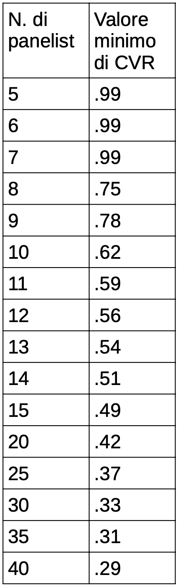
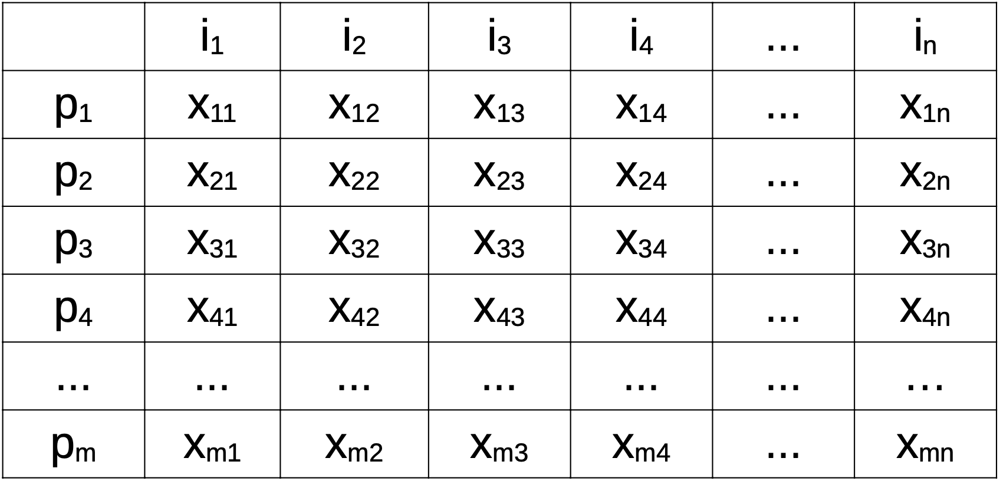
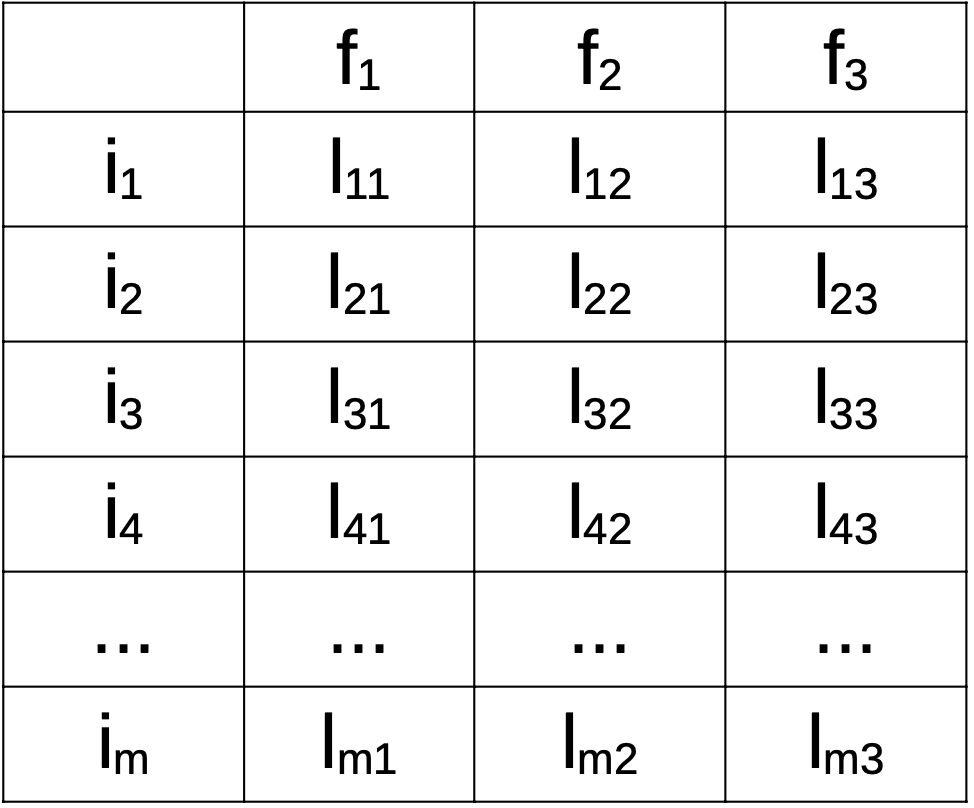
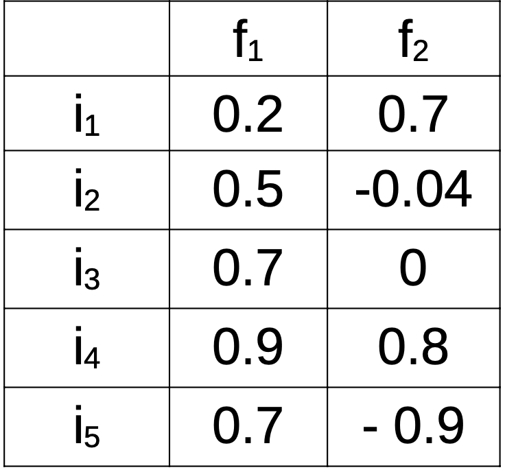
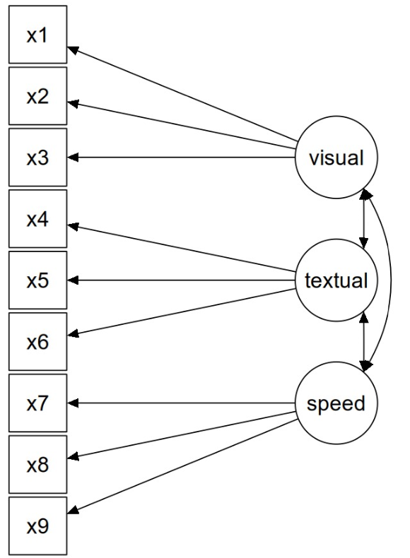
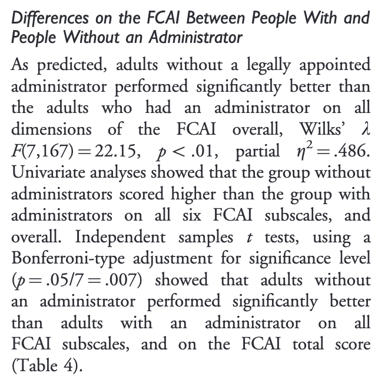
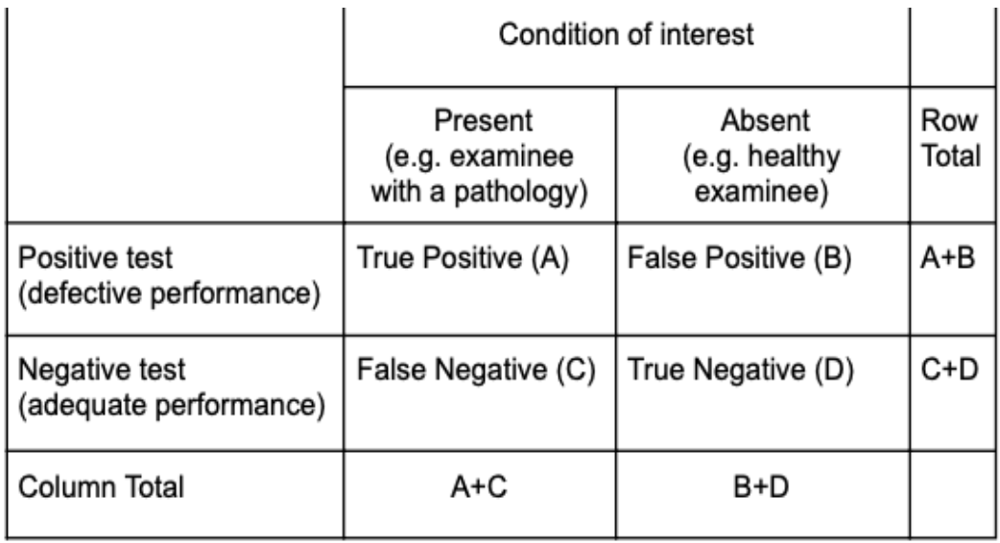
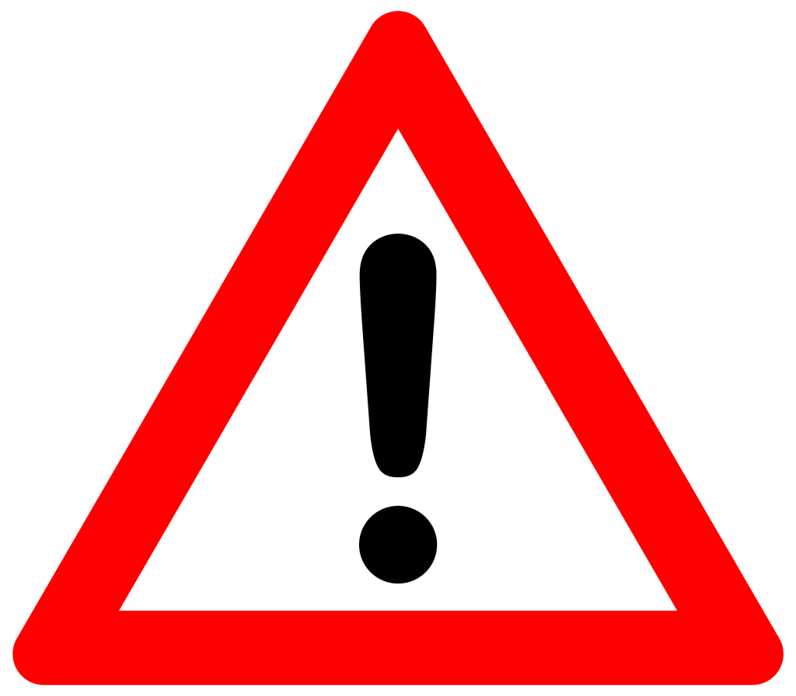

::: {.callout-note}
## Nota sull'uso dell'intelligenza artificiale

Questo handout è stato generato con l'assistenza di **Claude** (Anthropic), un modello di
intelligenza artificiale, a partire dalle slide della lezione 3b (*Validità – formule*). Al modello è
stato chiesto di riscrivere in forma discorsiva il contenuto delle slide, integrandone le figure,
**senza aggiungere nuovo materiale**. Il testo può comunque contenere imprecisioni: in caso di dubbio
fanno fede le slide e quanto detto a lezione.

Materiale distribuito con licenza CC BY-NC 3.0, come le slide del corso.
:::

# Tipi di validità

Il libro di riferimento del corso, *Oltre i punteggi* [@arcara2025oip], adotta la cornice degli *Standards for Educational and
Psychological Testing* [@aera2014standards], secondo cui la validità è un **concetto unitario**,
valutato attraverso cinque fonti di evidenza. In questo handout vediamo la versione quantitativa
delle etichette classiche più diffuse: la validità di contenuto, la validità convergente/divergente
(cioè la validità di costrutto), la validità di criterio e la validità ecologica. A queste si
aggiunge la validità di facciata, che però è un concetto storico e viene trattata a parte.

Conviene leggere queste etichette come una sequenza di domande diverse rivolte allo stesso test. La
**validità di contenuto** chiede se, secondo gli esperti, gli item sono adeguati a valutare il
costrutto. La **validità di costrutto** chiede se, nei dati, gli item e il punteggio totale si
comportano come ci si aspetterebbe se il test misurasse davvero quel costrutto: lo si vede sia dalla
struttura interna del test sia dalle sue relazioni con altre variabili. La **validità di criterio**
chiede se il test si associa a un outcome osservabile, il *gold standard*. In chiusura vediamo due
etichette particolari: la **validità di facciata**, un concetto storico che riguarda quanto il test
*sembra* misurare ciò che dichiara, e la **validità ecologica**, che riguarda i comportamenti nella
vita quotidiana.

Per un approfondimento sulle classificazioni più classiche si veda @urbina2004essentials.

# Validità di contenuto

::: {.callout-tip}
## Definizione: validità di contenuto

La **validità di contenuto** è la proprietà degli item di essere sufficienti e adeguati per valutare
il costrutto di interesse.
:::

Un modo per quantificarla è il metodo di @lawshe1975quantitative, che permette di ottenere una misura di
validità di contenuto sia per i singoli item sia per il test nel suo complesso. Il metodo si articola
in tre passaggi, a cui se ne può aggiungere un quarto opzionale.

**Passo 1.** Si chiede a un gruppo di esperti (i *panelist*) di valutare ciascun item, classificandolo
come *essenziale*, *utile ma non essenziale* oppure *non necessario*.

**Passo 2.** Per ogni item si calcola un *Content Validity Ratio* (CVR).

::: {.callout-tip}
## Definizione: Content Validity Ratio (CVR)

$$
CVR = \frac{n_e - \frac{N}{2}}{\frac{N}{2}}
$$

dove $n_e$ è il numero di panelist (cioè di esperti) che giudicano l'item essenziale e $N$ è il
numero totale di panelist. Il CVR varia da $-1$ a $1$ e vale $0$ quando esattamente metà dei
panelist giudica l'item essenziale. **Il CVR si riferisce a ciascun item, non al test.**
:::

Per comodità e per convenzione, ogni valore pari a 1 viene aggiustato a 0.99.

**Passo 3.** Si selezionano gli item da mantenere. Ma quali? Lawshe fornisce una tabella di valori
critici di CVR (@fig-lawshe); in alternativa, si mantengono gli item con CVR $\geq 0.78$ [@polit2007cvi].

{#fig-lawshe width="22%" fig-align="center" fig-pos="t"}

**Passo 4 (opzionale).** Dai CVR dei singoli item si può passare a un valore riferito all'intero
test, il *Content Validity Index* (CVI).

::: {.callout-tip}
## Definizione: Content Validity Index (CVI)

Il CVI è la **media** dei CVR di tutti gli item del test:

$$
CVI =
\frac{
  \displaystyle
  \sum_{I_1}^{I_k}
  \left(
    \frac{
      n_e - \frac{N}{2}
    }{
      \frac{N}{2}
    }
  \right)
}{
  k
}
$$

dove, oltre a $n_e$ e $N$ già definiti, $k$ è il numero degli item e $I$ indica gli item che
compongono il test.
:::

## Note sul metodo di Lawshe

È interessante notare che il metodo risponde solo in parte alla domanda sulla validità di contenuto.
Il metodo di Lawshe dice se un dato item è appropriato per il test, ma non se il test contiene tutti
gli item necessari per i suoi scopi. Nell'articolo originale, infatti, Lawshe discute alcuni esempi
in cui gli item di partenza sono già stati definiti e il problema è stabilire se siano appropriati.

Va detto infine che la validità di contenuto spesso non è considerata né riportata nei test (non è
molto di moda).

C'è poi un limite più generale: il metodo di Lawshe si basa interamente sul giudizio degli esperti.
Ci dice se gli item *sembrano appropriati* a chi conosce il costrutto, ma non come gli item si
comportano quando il test viene somministrato, né se misurano davvero il costrutto. Per rispondere a
queste domande bisogna guardare ai dati: è il terreno della validità di costrutto.

# Validità di costrutto

::: {.callout-tip}
## Definizione: validità di costrutto

La **validità di costrutto** esprime quanto il test misura effettivamente il costrutto che intende
misurare, valutando la coerenza interna degli item oppure la correlazione con altri test.
:::

## Due livelli, due fonti di evidenza

La validità di costrutto può essere valutata in due maniere: verificando se gli **item** misurano in
maniera appropriata il costrutto, oppure verificando se il **punteggio totale del test**[^1] misura
in maniera appropriata il costrutto, cioè se lo rappresenta correttamente.

[^1]: Nella maggior parte dei casi il punteggio totale si ottiene sommando gli item (in alcuni casi
facendone la media).

Questi due livelli corrispondono, secondo gli *Standards*, a **due fonti di
evidenza distinte**. Il livello degli item riguarda la **struttura interna** del test, e si indaga
con la consistenza interna, l'analisi fattoriale e la PCA. Il livello del punteggio totale riguarda le
**relazioni con altre variabili**, e si indaga soprattutto con la correlazione. Per comodità, e come
avviene nei manuali dei test neuropsicologici, qui entrambe restano sotto l'etichetta classica di
"validità di costrutto". Le sottosezioni che seguono rispettano questo ordine: prima la struttura interna,
poi le relazioni con altri test.

## Consistenza interna

Uno dei modi classici per vedere se tutti gli item di un test si comportano in maniera coerente è
valutarne la consistenza interna, tramite metriche come l'alpha di Cronbach. Questa, però, è spesso
associata più all'affidabilità, e per questo è trattata nella lezione sulle formule
dell'affidabilità.

La consistenza interna ci dice se gli item sono coerenti *nel complesso*; per capire *come* gli item
si raggruppano, e attorno a quali variabili latenti, si usa l'analisi fattoriale.

## Analisi fattoriale

L'analisi fattoriale è l'analisi statistica più comunemente utilizzata per valutare gli item.

::: {.callout-tip}
## Definizione: analisi fattoriale

Nel contesto della teoria dei test, l'**analisi fattoriale** indaga se gli item di un test si
comportano in maniera coerente, dimostrando che misurano una stessa variabile latente (detta
**fattore**).
:::

Operativamente, e per questi scopi, l'analisi viene condotta su una matrice $m \times n$, in cui (come
nella figura) i partecipanti sono in riga e gli item in colonna.

{width="50%" fig-align="center"}

Il risultato di un'analisi fattoriale è spesso una matrice di *loadings*.

::: {.callout-tip}
## Definizione: loading

Il **loading** ($l$) indica quanto ciascun item ($i$) è correlato con un determinato fattore ($F$).
:::

Esistono delle *rule of thumb* per stabilire se un loading è significativo, ad esempio valori
maggiori di 0.3 o 0.5 (oppure minori di $-0.3$ o $-0.5$).

{width="45%" fig-align="center"}

Vediamo due esempi in cui gli item caricano su due fattori. Nel primo, un fattore cattura una
correlazione positiva tra gli item 1, 2 e 3, che tendono ad avere punteggi correlati tra loro; il
secondo fattore cattura una correlazione positiva tra gli item 4 e 5, anch'essi con punteggi
correlati tra loro. È uno scenario ideale, in cui gli item "caricano" chiaramente e in maniera
distinta su specifici fattori.

{width="30%" fig-align="center"}

Nel secondo esempio, il primo fattore cattura una correlazione positiva tra gli item 2, 3, 4 e 5,
che tendono ad avere punteggi tutti correlati tra loro. Il secondo fattore cattura invece una
correlazione negativa degli item 1 e 4 rispetto all'item 5: in sostanza, quando i punteggi degli
item 1 e 4 sono alti, quelli dell'item 5 sono bassi, e viceversa. Questo è uno scenario più
complesso (e più comune): il fatto che un item carichi su più fattori (*cross-loadings*) può
indicare che l'item non è adeguato o che il modello teorico va rivisto.

{width="30%" fig-align="center"}

Esistono due tipi principali di analisi fattoriale, che si distinguono per lo scopo.

::: {.callout-tip}
## Definizione: analisi fattoriale esplorativa e confermativa

L'**analisi fattoriale esplorativa** ha lo scopo di definire quale struttura fattoriale descriva
meglio (se esiste) la relazione tra gli item. L'**analisi fattoriale confermativa** ha lo scopo di
verificare se gli item si comportano in maniera conforme a una struttura fattoriale nota.
:::

Nel contesto della validità di costrutto, l'analisi fattoriale può essere usata per selezionare gli
item che comporranno il test finale, ad esempio escludendo quelli che non si comportano in maniera
adeguata rispetto al costrutto (o ai costrutti) che si intendeva misurare. Se un test intende
misurare un singolo costrutto e tutti gli item tranne uno hanno loading alti su un fattore,
probabilmente quell'item andrebbe eliminato dalla versione finale del test.

Per valutare la bontà di un'analisi fattoriale esistono molte analisi statistiche e metriche. Tra le
più comuni c'è il test di *Goodness-of-Fit* (un test che riporta un Chi-quadro), che deve risultare
**non significativo ($p > 0.05$)**: se è significativo, la struttura a fattori proposta non è
sufficiente a spiegare la variabilità dei dati. Un'altra metrica è il **RMSEA** (*Root Mean Squared
Error of Approximation*), che deve essere il più basso possibile; di solito un valore $< 0.06$ è
considerato una soglia minima.

L'analisi fattoriale è spesso rappresentata graficamente, distinguendo i fattori latenti (qui
rappresentati da cerchi) dalle variabili osservate (qui rappresentate da quadrati).

{width="55%" fig-align="center"}

Per interpretare se un'analisi fattoriale supporta effettivamente la validità di costrutto, bisogna
verificare se gli item si comportano davvero come il test assume che dovrebbero comportarsi. Ad
esempio, se un test sostiene di misurare un costrutto specifico (come l'attenzione visuospaziale),
tutti gli item dovrebbero caricare su un solo fattore (almeno principalmente). È innanzitutto utile
vedere se gli autori del test hanno effettuato un'analisi fattoriale per indagare la relazione tra
gli item e se li hanno selezionati di conseguenza (escludendone alcuni), o più in generale se c'è
stata una qualche fase di selezione degli item (ad esempio tramite correlazione).

Stabilire l'adeguatezza di un'analisi fattoriale non è comunque semplice, perché spesso è possibile
giustificare i risultati solo a posteriori, senza che questi abbiano influenzato la scelta di tenere
o meno certi item. Potrei, ad esempio, avere un test che assume di misurare uno specifico costrutto,
scoprire con un'analisi fattoriale esplorativa che in realtà la variabilità degli item è spiegata da
*due* fattori, e mantenere comunque tutti gli item sostenendo che sono probabilmente influenzati da
due fattori separati, coerenti con le aspettative teoriche (ad esempio attenzione visuospaziale e
funzioni esecutive). Questo problema delle giustificazioni a posteriori tornerà anche con le
correlazioni.

Si noti infine che a volte l'analisi fattoriale è applicata anche ai punteggi delle sottoscale che
compongono una batteria, ad esempio per l'APACS [@arcara2016apacs]. I principi sono gli stessi,
ma in questo caso le unità di analisi non sono singoli item bensì gruppi di item che compongono
sottoscale (nell'esempio, il task di Linguaggio Figurato 1, il task di Linguaggio Figurato 2, e così
via).

## Principal Component Analysis (PCA)

Nei manuali dei test, al posto dell'analisi fattoriale si incontra spesso un'analisi
concettualmente simile, la PCA.

::: {.callout-tip}
## Definizione: Principal Component Analysis (PCA)

La **PCA** ha lo scopo di *ottenere nuove variabili che catturano porzioni di varianza comune tra più
punteggi* (ad esempio item, o punteggi totali di test). Queste nuove variabili sono dette
**componenti principali**, da cui il nome dell'analisi.
:::

Anche il risultato della PCA è una matrice di loadings, simile a quella dell'analisi fattoriale. La
differenza è che nella PCA non si stimano "variabili latenti", e questo si riflette sia nella formula
sia nei risultati che si ottengono.

Potreste quindi trovare, nella documentazione di un test, una PCA invece di un'analisi fattoriale.
Le due si possono interpretare in maniera analoga, anche se sarebbe più corretto usare l'analisi
fattoriale, perché assume l'esistenza di variabili latenti, cosa spesso implicita quando si tratta di
item o di punteggi totali di test psicologici.

## Una nota su analisi fattoriale e PCA

Analisi fattoriale e PCA ci aiutano a capire come si raggruppano gli item e se lo fanno in maniera
coerente con il costrutto (o i costrutti) che dovrebbero misurare. Non garantiscono però che il
costrutto sia quello giusto, e pertanto forniscono solo un'informazione parziale sulla validità.

Immaginiamo di voler valutare la validità di costrutto di un test di memoria. Gli autori potrebbero
riportare un'analisi fattoriale che mostra che gli item correlano bene fra loro e sono riconducibili
a un'unica variabile latente. Questo è ottimo, ma *non garantisce che quella variabile latente sia
effettivamente la memoria*: il test potrebbe essere stato costruito in maniera sbagliata, e gli item
potrebbero essere consistenti per un altro motivo (ad esempio perché il test cattura soprattutto la
velocità psicomotoria).

Per capire *che cosa* il test stia misurando, la struttura interna non basta: bisogna guardare fuori
dal test, cioè a come il suo punteggio si relaziona con altri test. È la seconda fonte di evidenza,
che si indaga con la correlazione.

## Correlazione

Lo strumento più comune per verificare la validità di costrutto di un test è indagare la
correlazione tra il suo punteggio totale e i punteggi ottenuti ad altri test.

Non esiste una soglia universale [il libro è chiaro su questo, vedi @arcara2025oip]: ciò che conta è che la correlazione
con test dello stesso costrutto sia più alta di quella con test di costrutti diversi. Come regola
pratica è ragionevole aspettarsi che sia almeno moderata ($> 0.3$), ma verosimilmente anche di più.
I test neuropsicologici, specie nelle persone sane, tendono infatti a essere **molto correlati fra
loro**, e ci si attendono quindi correlazioni più alte; di fatto, sono proprio queste correlazioni ad
aver portato a ipotizzare il cosiddetto fattore *g* dell'intelligenza
(<https://en.wikipedia.org/wiki/G_factor_(psychometrics)>).

![Correlazioni tra alcuni test del NADL [@semenza2014nadl] e il NADL-F [@arcara2019nadlf].](../Figures/correlazione.png){width="50%" fig-align="center"}

L'aspetto critico nell'interpretare valori "soglia" di correlazione tra due test diversi è che
questi valori dipendono anche dagli errori dei rispettivi test, e quindi da aspetti legati alla
numerosità campionaria e all'affidabilità (temi ripresi nelle lezioni successive). Inoltre, come già
per l'analisi fattoriale, è sempre possibile "giustificare" a posteriori una differenza o un valore
basso (ad esempio: "la correlazione è bassa presumibilmente perché questo test coinvolge più
dell'altro le funzioni esecutive").

Anche l'assenza di correlazione, o una correlazione molto bassa, può essere usata a sostegno di una
buona validità di costrutto. In generale la validità di costrutto indica quanto bene stiamo misurando
lo specifico costrutto, e dimostrare che stiamo isolando bene la specifica funzione cognitiva va a
sostegno della validità di costrutto.

![Correlazioni tra test di vario tipo e il NADL-F [@arcara2019nadlf]. Il NADL-F non correla con la GDS (Geriatric Depression Scale), a sostegno della sua validità di costrutto.](../Figures/correlazione2.png){width="45%" fig-align="center"}

## Altre analisi

Analisi fattoriale e correlazione sono gli strumenti più comuni, ma abbiamo visto che entrambe
lasciano spazio a interpretazioni a posteriori. In generale, la validità di costrutto non è vincolata
a specifiche analisi statistiche e andrebbe valutata rispetto alla specifica domanda a cui cerca di
rispondere. In altre parole, piuttosto che cercare nei manuali o negli articoli specifiche analisi
("è stata fatta un'analisi fattoriale? ci sono correlazioni?"), dovreste cercare di rispondere a
questa domanda:

> *Esistono evidenze sperimentali che suggeriscono che il test stia misurando quello che intende
> misurare?*

Ad esempio, un test che ha come obiettivo valutare la capacità di lavorare potrebbe non avere alcuna
correlazione con altri test, ma essere buono nel discriminare le persone che sono state licenziate da
quelle che hanno mantenuto il lavoro (in questo caso con una regressione logistica o con altre
analisi più legate alla discriminazione).

Un esempio reale viene da @kershaw2008assessment. Il FCAI è un test per la valutazione delle
competenze finanziarie; per dimostrarne la validità di costrutto, gli autori hanno confrontato
(tramite MANOVA) partecipanti con e senza tutore legale.

{width="50%" fig-align="center"}

È anche possibile combinare le analisi viste finora per supportare la validità di costrutto. Ad
esempio, @montemurro2023telegems, per dimostrare che il test Tele-GEMS era utile per valutare la
cognizione generale, hanno prima raccolto dati su vari test in pazienti (con Sclerosi Multipla, in
quel caso); hanno poi condotto una PCA su questi test, ottenendo un punteggio globale (la prima
componente) che catturava il 60% della varianza; infine hanno verificato se il punteggio al
Tele-GEMS correlava con questo punteggio globale. La correlazione era 0.50 (moderata/alta) ed è stata
interpretata a supporto di una buona validità di costrutto del test.

Un altro esempio, ipotetico, di come combinare le analisi: se l'analisi fattoriale mostra che gli
item si comportano come se catturassero due variabili latenti, una associata all'attenzione e una
alla memoria, sarebbe utile — e a supporto della validità di costrutto — che i punteggi ottenuti
sommando queste due parti correlassero rispettivamente con un altro test di attenzione e con un altro
test di memoria.

## Una possibile soluzione alla flessibilità: la pre-registrazione

Tutti gli esempi precedenti mostrano quanta flessibilità ci sia nella scelta e nell'interpretazione
delle analisi di validità di costrutto: un risultato inatteso, nell'analisi fattoriale come nelle
correlazioni, può quasi sempre essere giustificato a posteriori. Un possibile modo per risolvere
questo problema è *pre-registrare* le analisi e i risultati attesi per considerare buona la validità
di costrutto (per approfondimenti: <https://en.wikipedia.org/wiki/Preregistration_(science)>). Si
noti che la pre-registrazione risolve, *in generale*, i problemi di flessibilità o di scarsa
chiarezza delle analisi.

# Validità di criterio

Negli ultimi esempi (licenziati vs non licenziati, persone con e senza tutore legale) il test veniva
confrontato con qualcosa di osservabile. Quando l'interesse principale è proprio questo legame con
un outcome osservabile si parla di validità di criterio.

::: {.callout-tip}
## Definizione: validità di criterio

La **validità di criterio** valuta quanto un test è associato a, o predice, un'altra variabile di
outcome (osservabile), detta **gold standard**.
:::

Le analisi da utilizzare, e il modo di valutarne i risultati, cambiano a seconda che il criterio sia
una variabile continua (ad esempio il punteggio a un altro test) oppure una variabile categoriale (ad
esempio l'appartenenza a un gruppo, come MCI vs controlli).

La validità di criterio può essere distinta in concorrente o predittiva (si vedano le slide
*Validità e affidabilità – teoria*), ma questa distinzione generalmente non cambia il modo in cui
vengono condotte le analisi, che dipende solo dal fatto che il criterio sia una variabile continua o
categoriale.

## Criterio continuo

Se il gold standard è una variabile continua, la validità di criterio si può valutare tramite una
correlazione, la stessa analisi vista per la validità di costrutto. Come riferimento indicativo,
valori pari o superiori a 0.70–0.80 sono considerati elevati in molti contesti applicativi (non si
tratta comunque di un requisito universale). A partire dalla correlazione si può calcolare la
varianza spiegata (nota anche come $r^2$), che non è altro che il coefficiente di correlazione al
quadrato.

A volte, per calcolare la validità di criterio, si usa la regressione lineare. Nel caso di due
variabili la regressione lineare è strettamente imparentata con il coefficiente di correlazione (e
infatti alcuni dei risultati sono matematicamente identici).

## Criterio categoriale

Nel caso di variabili categoriali (ad esempio sopra/sotto cut-off, oppure MCI vs controlli) si
utilizzano famiglie di analisi diverse.

::: {.callout-tip}
## Definizione: condizione di interesse

Quando il criterio è categoriale, la categoria più rilevante (spesso quella patologica) è detta
**condizione di interesse**.
:::

Per ora diciamo solo che, quando si confronta un test con il suo criterio categoriale, esistono
quattro tipi di possibili risultati.

{width="50%" fig-align="center"}

Tutte le metriche legate a questa tabella rientrano nei concetti di sensibilità e specificità, che
saranno trattati in apposite lezioni (dopo i cut-off).

## Validità di criterio o di costrutto?

Poiché la correlazione si usa sia per la validità di costrutto sia per quella di criterio, è utile
chiedersi quale delle due etichette sia appropriata. Se l'interesse è misurare un costrutto
psicologico (ad esempio memoria o attenzione), sarebbe più pertinente parlare di **validità di
costrutto** e valutarla con i metodi discussi sopra: la misurazione riguarda infatti un concetto
inosservabile [costrutto, contrapposto a un criterio osservabile: @cronbach1955construct].

In ambito neuropsicologico e psicologico raramente il punteggio a un altro test va considerato un
criterio, ma ci sono eccezioni comuni: quando si vuole mostrare che un test breve è equivalente a uno
lungo o dispendioso (e allora quello lungo è il "criterio"), oppure quando si vuole mostrare che un
test online è equivalente a uno in presenza (le valutazioni in presenza sono di norma considerate il
gold standard).

# Validità di facciata (nota storica)

Fin qui abbiamo visto evidenze quantitative. La validità di facciata è di natura diversa: non
riguarda ciò che il test misura, ma ciò che *sembra* misurare.

::: {.callout-tip}
## Definizione: validità di facciata

La **validità di facciata** valuta quanto un test *sembra* misurare ciò che intende misurare.
:::

Il termine non compare negli *Standards* e viene qui trattato come
concetto storico, non come fonte tecnica di evidenza.

{width="8%" fig-align="center"}

Spesso è valutata tramite domande ad hoc rivolte a esperti, o tramite un confronto con test gold
standard esistenti, ma solo in modo qualitativo: a differenza del metodo di Lawshe, dove il giudizio
degli esperti viene quantificato, qui non si arriva a un indice. Talvolta la validità di facciata è
l'unica informazione disponibile su un test: non ci sono altre prove che il test misuri ciò che vuole
misurare, se non il fatto che è costruito con item che plausibilmente misurano proprio quel
costrutto.

## Validità di facciata in ambito forense

La validità di facciata può essere importante per assicurarsi la collaborazione del paziente e, in
contesto forense, anche perché persone che non sono psicologi (ad esempio il giudice) accettino le
conclusioni tratte. I test per identificare potenziali simulatori, ovviamente, non devono avere
validità di facciata: anzi, il loro scopo non dovrebbe essere evidente.

# Validità ecologica

Come per la validità di criterio, anche nella validità ecologica l'interesse è per comportamenti
osservabili; in questo caso, però, si tratta dei comportamenti che avvengono fuori dal setting di
valutazione.

::: {.callout-tip}
## Definizione: validità ecologica

La **validità ecologica** valuta quanto un test è in grado di prevedere comportamenti al di fuori del
setting di valutazione, cioè nella vita quotidiana.
:::

Spesso è studiata tramite correlazioni con altre scale riferite a comportamenti della vita
quotidiana: diversamente da molti test, qui l'interesse non è per i costrutti ma per *altri
comportamenti*. Può essere valutata anche con altre analisi, purché mostrino che i punteggi al test
sono associati al fenomeno di vita quotidiana di interesse.

Ad esempio, si potrebbe indagare la correlazione tra il punteggio a un test di funzioni esecutive e
il numero di comportamenti antisociali mostrati da un paziente durante un ricovero, per supportare
l'idea che le informazioni fornite dal test siano associate a comportamenti legati alle funzioni
esecutive nella vita quotidiana.

# In sintesi {.unnumbered}

Le diverse etichette viste in questo handout non sono validità separate, ma modi diversi di
raccogliere evidenze a favore di un unico concetto di validità. Nessuna singola analisi, presa da
sola, basta a stabilirla: la domanda da porsi resta sempre se esistano evidenze che il test misuri
ciò che intende misurare.

# Riferimenti {.unnumbered}

::: {#refs}
:::
