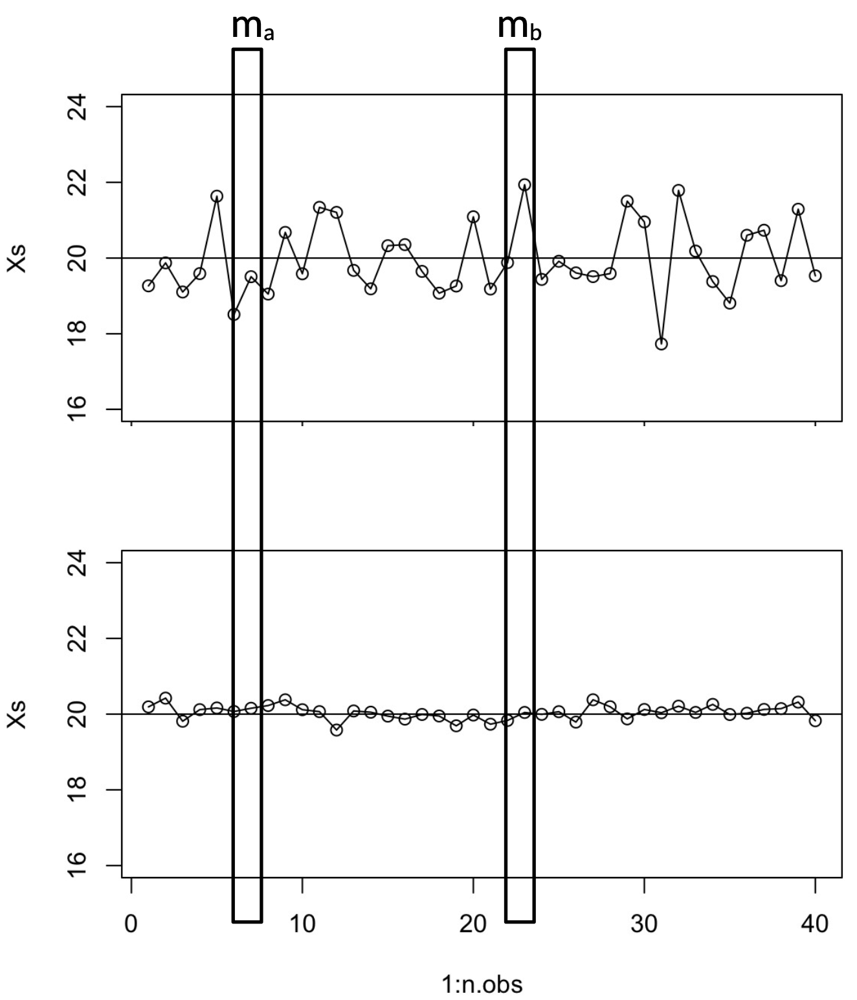
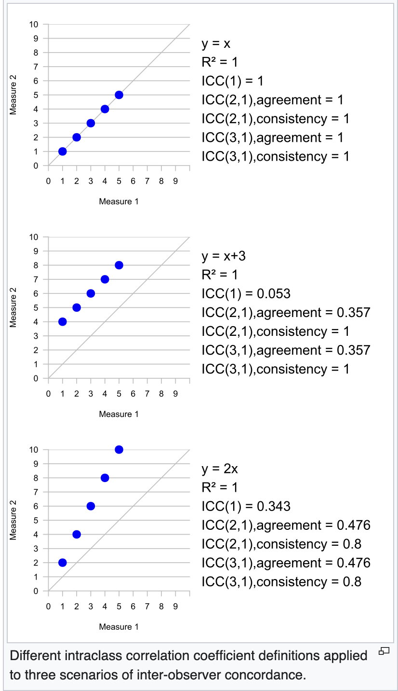

::: {.callout-note}
## Nota sull'uso dell'intelligenza artificiale

Questo handout è stato generato con l'assistenza di **Claude** (Anthropic), un modello di
intelligenza artificiale, a partire dalle slide della lezione 3c (*Affidabilità – formule*) e usando
come riferimento il libro del corso, *Oltre i punteggi* [@arcara2025oip]. Al modello è stato chiesto
di riscrivere in forma discorsiva il contenuto delle slide, integrandone le figure, **senza aggiungere
nuovo materiale**. Il testo può comunque contenere imprecisioni: in caso di dubbio fanno fede le
slide, il libro e quanto detto a lezione.

Materiale distribuito con licenza CC BY-NC 3.0, come le slide del corso.
:::

# Affidabilità/precisione

::: {.callout-tip}
## Definizione: affidabilità

L'**affidabilità** è la qualità di un test di fornire punteggi consistenti in diverse misurazioni;
può essere intesa come la precisione di un test [@arcara2025oip].
:::

Gli *Standards for Educational and Psychological Testing* [@aera2014standards] trattano
l'affidabilità come un **principio unitario**, usando il termine ombrello *affidabilità/precisione*:
non si tratta di un'unica proprietà, ma di un insieme di stime di precisione, ciascuna specifica a
una **fonte di errore**. Le stime classiche sono tre, e ognuna guarda a una fonte di errore diversa:
l'**affidabilità test-retest** riguarda il momento in cui il test viene somministrato,
l'**inter-rater agreement** riguarda chi attribuisce il punteggio, la **consistenza interna** (con la
sua versione più semplice, l'affidabilità split-half) riguarda gli item che compongono il test.
L'handout le tratta in quest'ordine, per poi vedere come i diversi coefficienti si interpretano e si
combinano a livello dell'intero test.

La terminologia usata è quella della Teoria Classica dei Test, il modello dominante per i test
neuropsicologici; la *Generalizability Theory* e l'*Item Response Theory* usano termini diversi. Per
le classificazioni si veda @urbina2004essentials.

## Quanto deve essere alta l'affidabilità?

Non esistono soglie universali. Come riferimento orientativo, valido per tutti i tipi di
affidabilità, si può usare la classificazione riportata da @slick2006psychometrics:

| Coefficiente | Interpretazione |
|:--|:--|
| $\geq 0.90$ | molto alta |
| $0.80 - 0.89$ | alta |
| $0.70 - 0.79$ | adeguata |
| $0.60 - 0.69$ | marginale |
| $< 0.60$ | bassa |

: Classificazione orientativa dei coefficienti di affidabilità [@slick2006psychometrics].

Per le **decisioni cliniche sul singolo individuo**, Sattler [-@sattler2001assessment; citato in
@slick2006psychometrics] raccomanda soglie più stringenti: almeno 0.80; per le decisioni ad alto
impatto (per esempio la stima del QI o una diagnosi) 0.90 è il minimo, e 0.95 il valore ottimale. In
pratica conviene adottare un approccio *comparativo*: scegliere, tra i test disponibili, quello con
l'affidabilità migliore. Nelle sezioni che seguono, per ogni tipo di affidabilità sono riportate anche
soglie indicative specifiche.

# Affidabilità test-retest

::: {.callout-tip}
## Definizione: affidabilità test-retest

L'**affidabilità test-retest** è una misura della consistenza dei punteggi ottenuti quando lo stesso
test viene somministrato alle stesse persone in due momenti diversi, assumendo che nell'intervallo
tra le somministrazioni non si siano verificati cambiamenti reali nel costrutto misurato e che le
condizioni di valutazione siano comparabili [@arcara2025oip].
:::

Una formula molto diffusa per calcolarla, specie nei test in italiano, è la correlazione di Pearson:

$$
r = \frac{\sum (x_i - \bar{x})(y_i - \bar{y})}
{\sqrt{\sum (x_i - \bar{x})^2 \sum (y_i - \bar{y})^2}}
$$

dove $x_i$ e $y_i$ sono i punteggi al test e al retest, e $\bar{x}$ e $\bar{y}$ le rispettive medie.

## Test-retest ed effetti sistematici

Il coefficiente di correlazione esprime la *consistenza relativa* tra le due misurazioni, cioè quanto
le persone mantengono lo stesso ordinamento nelle due occasioni. Non cattura però eventuali *effetti
sistematici*: può essere molto alto anche quando i punteggi al retest sono sistematicamente più alti.

::: {.callout-tip}
## Definizione: effetto sistematico ed effetto pratica

Un **effetto sistematico** è una variazione non casuale nei punteggi tra test e retest, presente in
ogni individuo. Nei test cognitivi l'effetto sistematico più comune è l'**effetto pratica**:
l'etichetta che indica quei cambiamenti (spesso sistematici) che si osservano nella nuova
somministrazione del test e che sono associati a una prestazione migliore.
:::

Per capire perché la correlazione non vede gli effetti sistematici, immaginiamo che a ogni
osservazione del retest si aggiunga una quantità fissa $k$. Ne consegue che anche la media del retest
aumenta di $k$:

$$
r = \frac{\sum (x_i - \bar{x})(y_i + k - (\bar{y} + k))}
{\sqrt{\sum (x_i - \bar{x})^2 \sum (y_i + k - (\bar{y} + k))^2}}
$$

Con semplice algebra le $k$ si cancellano e si torna alla formula iniziale: un aumento sistematico
non cambia il valore della correlazione (si vedano anche le slide sulla correlazione nell'Appendice
sui concetti base di statistica).

Bisogna dunque fare attenzione all'uso e all'interpretazione dei valori di affidabilità test-retest
quando sono calcolati con una correlazione. In questo caso il coefficiente andrebbe accompagnato
dall'analisi dei cambiamenti sistematici tra la prima e la seconda valutazione: per esempio il
confronto tra le medie (con un t-test) e l'esame della distribuzione delle differenze
[ad esempio, @arcara2016apacs].

## Perché il test-retest conta anche per una singola valutazione

Spesso si pensa, erroneamente, che l'affidabilità test-retest sia utile solo quando si effettuano
misurazioni ripetute. Conviene invece immaginare una valutazione come una fotografia di una scena
statica: l'affidabilità test-retest stima quanto è precisa la macchina fotografica. Con un test ad
alta affidabilità non ci aspettiamo molte variazioni possibili da una misurazione all'altra; con un
test a bassa affidabilità, invece, ce ne aspettiamo molte. La nostra fotografia sarà una stima
"puntuale", ma potrebbe essere lontana da quello che consideriamo il punteggio vero (che, ricordiamo,
è un'entità teorica).

La @fig-retest mostra questo concetto con due test, uno a bassa e uno ad alta affidabilità test-retest, e
due singole misurazioni ipotetiche, $m_a$ e $m_b$. Per ciascun test si fa una sola valutazione e non
c'è alcun interesse a rivalutare nel tempo; eppure, con il test ad alta affidabilità il punteggio
osservato dipende molto meno dalla specifica occasione di misurazione.

## Dalla correlazione all'ICC

Perché si usa così spesso la correlazione di Pearson, se non è del tutto adeguata? Probabilmente per
convenzione e per semplicità: tra l'altro $r$ permette di esprimere facilmente la varianza condivisa
tra le variabili, semplicemente calcolando $r^2$. Non è del tutto sbagliato, e può fornire un quadro
abbastanza completo se è accompagnato da t-test che indaghino le differenze sistematiche.

{#fig-retest width="40%" fig-align="center" fig-pos="t"}

Esistono comunque altri modi di misurare l'affidabilità test-retest, e sempre più spesso si usano
formule più appropriate, in particolare l'**Intraclass Correlation (ICC)** basata sull'*accordo
assoluto*, che tiene conto anche degli effetti sistematici. Nel tipico disegno test-retest, con due
occasioni prestabilite e uguali per tutti, si raccomanda un modello ICC a due vie, a effetti misti,
basato sull'accordo assoluto e riferito a una singola misurazione, spesso indicato come ICC(2,1) o
ICC(A,1) [@shrout1979intraclass; @mcgraw1996forming; @koo2016guideline].

*Soglie indicative*: non esiste una soglia universalmente valida. Un coefficiente pari o superiore a
0.70 viene talvolta considerato un requisito minimo per finalità di ricerca o per confronti tra
gruppi. Quando il punteggio contribuisce a decisioni importanti sul singolo individuo sono
generalmente richiesti valori più elevati: spesso almeno 0.90 e, idealmente, circa 0.95
[@nunnally1994psychometric].

Le formule dell'ICC sono presentate nella prossima sezione, dedicata all'inter-rater agreement, dove
l'ICC è lo strumento principale.

# Inter-rater agreement

::: {.callout-tip}
## Definizione: inter-rater agreement

L'**inter-rater agreement** (o *affidabilità inter-rater*) misura quanto è consistente il punteggio
assegnato da valutatori diversi che osservano la stessa prestazione. È, praticamente per
definizione, legato all'*oggettività* del test, cioè all'indipendenza del risultato
dall'osservatore.
:::

L'inter-rater agreement è tendenzialmente più basso nei test in cui la risposta non è univoca o è
graduata (per esempio disegno, descrizione, interpretazione di proverbi), e più alto quando la
risposta corretta è univoca e dicotomica (per esempio il digit span). Al di là della complessità del
comportamento da valutare, l'elemento cruciale e trasversale è la **chiarezza delle regole di
attribuzione dei punteggi**, comprese le indicazioni su come comportarsi nei casi ambigui.

## L'Intraclass Correlation (ICC)

La formula più utilizzata per l'inter-rater agreement è l'ICC. A differenza della correlazione, che
mette in relazione solo due variabili, l'ICC può essere usata con $k$ valutatori (*rater*).

::: {.callout-tip}
## Definizione: Intraclass Correlation (ICC)

L'**ICC** non è un singolo coefficiente ma una **famiglia** di coefficienti, che assumono relazioni
diverse tra gruppi e osservazioni e si basano sulla scomposizione della varianza (ANOVA o modelli a
effetti misti). Per l'inter-rater agreement sono rilevanti le ICC basate sull'**accordo assoluto**,
che assumono valori alti solo se i valutatori assegnano più o meno lo stesso punteggio, e non solo
se i loro punteggi sono correlati.
:::

Per approfondire si può consultare la voce di Wikipedia
(<https://en.wikipedia.org/wiki/Intraclass_correlation>).

Una versione spesso utilizzata è l'**ICC(2,1) agreement**, in cui si assume che diversi valutatori
osservino la stessa prestazione dello stesso soggetto e si ottiene una stima dell'accordo in termini
assoluti:

$$
ICC(2,1) = \frac{MSB - MSE}
{MSB + (n_j - 1)MSE + \frac{n_j(MSJ - MSE)}{n_c}}
$$

dove $MSB$ e $MSJ$ sono la varianza tra soggetti e la varianza tra giudici (*rater*), $MSE$ è la
varianza dell'interazione giudici $\times$ soggetti, $n_j$ è il numero di giudici e $n_c$ il numero
di casi.

La figura mostra come relazioni diverse tra due misurazioni vengano catturate da coefficienti
diversi. Si noti che $R^2$ è il coefficiente di correlazione $r$ elevato al quadrato, ma è anche usato
nelle regressioni (in breve, analisi statistiche in cui si indaga la relazione tra variabili usando
equazioni del tipo $y = bx + e$). Nel secondo e nel terzo pannello $R^2$ e le ICC di consistenza
restano alte, mentre le ICC di accordo si abbassano.

{width="45%" fig-align="center"}

## Alcune considerazioni sull'ICC

Se l'ICC tiene conto anche delle differenze sistematiche, perché non viene sempre usata anche per il
test-retest? Probabilmente per prassi e convenzione, che si osservano soprattutto nei test in
italiano. In letteratura si trovano comunque studi che la usano anche per il test-retest, e nel corso
degli anni sempre più autori adottano questa formula più appropriata: in presenza di effetto pratica
sarebbe infatti più adeguata.

*Soglie indicative* per l'inter-rater agreement (ICC): secondo Cicchetti e Sparrow
[-@cicchetti1981developing; citati in @slick2006psychometrics] valori inferiori a 0.40 sono scarsi,
tra 0.40 e 0.59 discreti, tra 0.60 e 0.74 buoni, pari o superiori a 0.75 eccellenti. Con una
classificazione simile, @fastenau1996application considerano 0.60 la soglia per un accordo
"sostanziale" e 0.75–0.80 per un accordo "quasi perfetto".

Dopo il momento della somministrazione e il valutatore, resta la terza fonte di errore: gli item che
compongono il test.

# Split-half e consistenza interna

## Affidabilità split-half

::: {.callout-tip}
## Definizione: affidabilità split-half

L'**affidabilità split-half** indica la consistenza di un test quando si confronta il punteggio
totale ottenuto da metà degli item con il punteggio totale ottenuto con la rimanente metà degli item
[@arcara2025oip].
:::

Un approccio tradizionale per valutare la consistenza degli item di un test è dividerlo in due
(tipicamente gli item pari da un lato e i dispari dall'altro) e calcolare, sui partecipanti, la
correlazione tra i punteggi delle due metà. Poiché ciascuna metà è più corta dell'intero test, questa
correlazione **sottostima** l'affidabilità del test completo: si applica quindi la correzione di
**Spearman-Brown**.

Il limite principale è che il risultato dipende, almeno in parte, da come si divide il test. Per
questo si preferisce la sua estensione, la consistenza interna. *Soglia indicativa*: pari o superiore
a 0.70–0.80 [@slick2006psychometrics].

## Consistenza interna

::: {.callout-tip}
## Definizione: consistenza interna

La **consistenza interna** misura quanto gli item di un test siano tra loro coerenti, cioè quanto
misurino, almeno in parte, la stessa cosa [@arcara2025oip].
:::

Concettualmente, la consistenza interna stima quale sarebbe la correlazione media considerando
*tutte* le possibili divisioni split-half. È un concetto a cavallo tra affidabilità e validità, perché
riguarda anche la struttura fattoriale del test (si veda l'handout sulle formule della validità).

Esistono diverse formule per calcolarla. La formula di Kuder-Richardson (KR-20) si usa quando gli
item sono dicotomici (0/1); l'alpha di Cronbach è l'indice più diffuso, e generalizza la KR-20 al
caso di item non dicotomici.

::: {.callout-tip}
## Definizione: formula di Kuder-Richardson (KR-20)

$$
r_{KR20} = \left(\frac{n}{n-1}\right)\frac{s_t^2 - \sum{pq}}{s_t^2}
$$

dove $n$ è il numero di item del test, $s_t^2$ la varianza del punteggio totale, $\sum pq$ la somma,
su tutti gli item, del prodotto $p \times q$; $p$ è la proporzione di persone che superano l'item (o
rispondono 1) e $q$ la proporzione di persone che non lo superano (o rispondono 0).
:::

::: {.callout-tip}
## Definizione: alpha di Cronbach

$$
\alpha = \left(\frac{n}{n-1}\right)\frac{s_t^2 - \sum{s_i^2}}{s_t^2}
$$

dove $n$ è il numero di item del test, $s_t^2$ la varianza del punteggio totale e $s_i^2$ la
varianza di ciascun item.
:::

L'alpha è un *limite inferiore* dell'affidabilità e assume item (essenzialmente) tau-equivalenti e
unidimensionali.

## Altri metodi per calcolare la consistenza interna

Sebbene KR-20 e alpha siano i più comuni, hanno limiti intrinseci, per esempio l'assunzione di
unidimensionalità. Per questo esistono alternative. L'**omega di McDonald** ($\omega$) è
un'alternativa più recente e considerata **più robusta**, adatta anche in caso di
multidimensionalità, e oggi spesso raccomandata come scelta di default. Il **GLB** (*Greatest Lower
Bound*) è preferibile se i punteggi degli item non sono distribuiti normalmente. Omega e GLB sono
legati all'analisi fattoriale (si vedano le slide sulla validità) e sono computazionalmente più
complessi. Per i **test di velocità** la consistenza interna non è una misura appropriata.

*Soglie indicative*: valori inferiori a 0.70 sono considerati inaccettabili, tra 0.70 e 0.79
discreti, tra 0.80 e 0.89 buoni, pari o superiori a 0.90 eccellenti [@slick2006psychometrics]; nei
test neuropsicologici la consistenza interna è però spesso intorno a 0.60.

## Item selection

Alla consistenza interna è associato il concetto di **item selection**: la procedura con cui, nella
costruzione di un test, si identificano gli item da mantenere nella versione finale. Alcune misure
sono specifiche per i singoli item, un po' come i loadings nell'analisi fattoriale. Due esempi
derivano dall'alpha di Cronbach.

::: {.callout-tip}
## Definizione: r-drop e r-cor

L'**r-drop** indica la correlazione tra il test e il test privato di quell'item: si ha quindi un
valore di r-drop per ogni item. L'**r-cor** indica la correlazione tra l'item e il test totale,
controllando per la sovrapposizione con gli altri item e per l'affidabilità globale.
:::

# Interpretare l'affidabilità a livello del test

Abbiamo visto coefficienti diversi, calcolati con formule diverse ($r$ di Pearson, ICC(2,1), alpha,
ecc.), per fonti di errore diverse. Tutti, però, condividono la stessa idea di fondo e si possono
interpretare allo stesso modo.

::: {.callout-tip}
## Definizione: coefficiente di affidabilità

Ogni coefficiente di affidabilità stima la varianza riconducibile al punteggio vero rispetto alla
variabilità totale, cioè quella che si rileva nei punteggi osservati:

$$
r_{xx} = \frac{\sigma^2_{true}}{\sigma^2_{tot}}
$$
:::

Per questo motivo ogni coefficiente, indipendentemente dalla formula, può essere letto come la
percentuale di variabilità riconducibile al punteggio vero, trasformandolo semplicemente in
percentuale. Una correlazione test-retest di 0.8 significa che l'80% della variabilità test-retest è
riconducibile alla variabilità del punteggio vero; una consistenza interna di 0.9 significa che il 90%
della variabilità nella consistenza interna è riconducibile alla variabilità del punteggio vero, e
così via.

Di conseguenza, l'errore associato a ogni fonte di affidabilità è calcolabile come:

$$
Errore = (1-C_a) \times 100
$$

dove $C_a$ è il coefficiente di affidabilità in questione (per esempio test-retest o inter-rater).

## Combinare diversi tipi di errore

Calcolando l'errore per diverse fonti, è possibile sommarle (assumendo che siano indipendenti) per
ottenere un errore totale, e quindi la parte di variabilità del punteggio che si presume
riconducibile al punteggio vero. Supponiamo di avere un test con un'affidabilità test-retest di 0.85
($r$ di Pearson), un'affidabilità inter-rater di 0.70 (ICC(2,1)) e una consistenza interna di 0.97
(alpha di Cronbach). Gli errori sono:

- test-retest: $(1-0.85) \times 100 = 15\%$;
- inter-rater: $(1-0.70) \times 100 = 30\%$;
- consistenza interna: $(1-0.97) \times 100 = 3\%$;

per un errore totale di $15 + 30 + 3 = 48\%$. A livello del test, quindi, il 48% della varianza è
riconducibile all'errore e il 52% ($100 - 48$) al punteggio vero; quest'ultimo valore è anche
l'affidabilità complessiva del test [per un esempio simile si veda @urbina2004essentials].

Attenzione: questa scomposizione additiva assume che le fonti di errore siano *indipendenti* ed è un
artificio grossolano. Nella pratica psicometrica la precisione complessiva si esprime più
propriamente con l'errore standard di misurazione (*SEM*) e con i relativi intervalli di confidenza,
che qui non approfondiamo.

## Affidabilità ed errore

In questo approccio, più informazioni abbiamo sulle diverse fonti di errore, più bassa risulta la
percentuale riconducibile alla varianza del punteggio vero. Detto altrimenti, stimare la varianza
riconducibile al punteggio vero a partire da un solo indice porta inevitabilmente a sovrastimarla.

# Stimare il punteggio vero

Le formule di affidabilità permettono anche di stimare il punteggio vero:

$$
T' = r_{xx}(X-M)+M
$$

dove $T'$ è la stima del punteggio vero, $r_{xx}$ l'affidabilità complessiva (vedi la sezione
precedente), $X$ il punteggio osservato e $M$ la media del campione di riferimento.

Su questa formula valgono tre note. La prima: la stima del punteggio vero è spesso accompagnata da
intervalli di confidenza attorno alla stima (un tema che riprenderemo parlando di cut-off; si veda
anche l'Appendice).

La seconda: nella formula la media del campione di riferimento ($M$) entra due volte. Questo
permette di tenere conto di un fenomeno noto come regressione verso la media.

::: {.callout-tip}
## Definizione: regressione verso la media

In ogni misura affetta da errore è sempre più probabile che una misura successiva sia più vicina
alla media del campione di riferimento. Questo accade perché, specie se l'errore dello strumento è
grande, ogni deviazione dalla media ha una certa probabilità di essere dovuta al caso.
:::

Correggere per la media ha però un grosso limite intrinseco: con quale media correggere? Per esempio,
se valutiamo un paziente con trauma cranico (TBI), è corretto usare come $M$ la media del gruppo di
persone sane con cui è stato sviluppato il test?

La terza: limiti di questo tipo rendono complessa l'applicazione delle formule per stimare il
punteggio vero. Come vedremo negli utilizzi clinici e pratici (per esempio cut-off e valori di
cambiamento), **quasi sempre non si usano i punteggi veri ma i punteggi osservati**.

# In sintesi {.unnumbered}

L'affidabilità non è una proprietà unica: ogni coefficiente stima la precisione del test rispetto a
una specifica fonte di errore (momento della somministrazione, valutatore, item), e tutti si possono
leggere come quota di varianza riconducibile al punteggio vero. Le soglie sono solo indicative: nella
scelta di un test conviene un approccio comparativo, tenendo presente che per le decisioni sul
singolo individuo servono valori più alti.

# Riferimenti {.unnumbered}

::: {#refs}
:::
