::: {.callout-note}
## Nota sull'uso dell'intelligenza artificiale

Questo handout è stato generato con l'assistenza di **Claude** (Anthropic), un modello di
intelligenza artificiale, a partire dalle slide della lezione 4b (*Confronto con dati normativi –
Formule*) e usando come riferimento il libro del corso, *Oltre i punteggi* [@arcara2025oip]. Al
modello è stato chiesto di riscrivere in forma discorsiva il contenuto delle slide, integrandone le
figure, **senza aggiungere nuovo materiale**. Il testo può comunque contenere imprecisioni: in caso di
dubbio fanno fede le slide, il libro e quanto detto a lezione.

Materiale distribuito con licenza Creative Commons Attribuzione – Non commerciale 4.0 Internazionale
(CC BY-NC 4.0, <https://creativecommons.org/licenses/by-nc/4.0/deed.it>).
:::

Questo handout riprende, dal punto di vista delle formule, il confronto con i dati normativi. Il
percorso è il seguente: il concetto di soglia espresso in termini di percentuali o probabilità; i
punti z e il loro legame con le probabilità; le distribuzioni non normali e i percentili non
parametrici; la distinzione tra campione e popolazione; il test per il caso singolo di Crawford e
Howell; i metodi di regressione per la correzione dei punteggi; infine il metodo dei Punteggi
Equivalenti.

# Il cut-off clinico e i valori soglia

Il cut-off clinico, e più in generale i valori soglia che delimitano certe percentuali, sono concetti
fondamentali della statistica applicata alla neuropsicologia clinica e forense. L'idea di fondo è
trovare un valore che aiuti a classificare la prestazione di una persona o, più in generale, a
stabilire quanto quella prestazione sia probabile o improbabile.

L'improbabilità è strettamente legata ai concetti di *deficit* e di presumibile *peggioramento*
cognitivo, che di fatto vengono operazionalizzati come una prestazione insolita, improbabile,
*assumendo che la persona sia nella norma*. L'uso delle probabilità in ambito clinico è però
insidioso, perché è facile sbagliare sia nel calcolo sia nell'interpretazione: formalizzare in modo
più rigoroso aiuta a evitare gli effetti di una terminologia vaga.

{width="55%" fig-align="center"}

::: {.callout-tip}
## Definizione: valore soglia per la prestazione deficitaria

Nei test in cui un punteggio basso indica una prestazione peggiore, definiamo valori utili alla
classificazione clinica, e in particolare alla classificazione di una **prestazione deficitaria**,
quei punteggi $x$ per cui la probabilità che un punteggio osservato $o$ sia inferiore a $x$ è al
massimo pari a $k$:

$$
\text{definiamo } x \text{ in modo tale che } P(o < x) \leq k
$$
:::

Con il classico "cut-off di normalità" $k = 0.05$: $x$ è il valore per cui c'è al massimo il 5% di
probabilità di osservare una prestazione inferiore. Una prestazione al di sotto di $x$ è dunque
improbabile, e da questo inferiamo un *deficit* o un *peggioramento*. Si usa $\leq$ e non $=$ perché i
punteggi sono in genere discreti: una probabilità esattamente pari a $k$ spesso non esiste, e si
sceglie la soglia che non supera $k$. Va sottolineato che **la soglia del 5% è completamente
arbitraria**.

I cut-off si possono calcolare con metodi diversi: metodi parametrici (media, deviazione standard e
punti z), metodi non parametrici (percentili non parametrici) e altri metodi, come le regressioni (per
esempio i Punteggi Equivalenti) e i metodi di Crawford.

# Percentili e punti z

La definizione appena data coincide con quella che in statistica si usa per i **percentili** di una
distribuzione. L'uso della curva normale e quello dei percentili non parametrici sono semplicemente
metodi diversi per identificare queste percentuali; i punti z non sono altro che un metodo
(parametrico) che semplifica l'identificazione dei percentili.

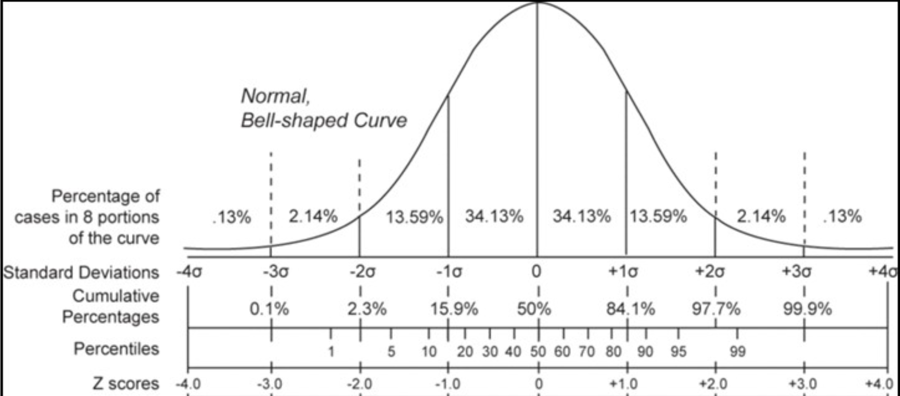{width="60%" fig-align="center"}

L'uso della curva normale, e della trasformazione in punti z, ha senso proprio perché aiuta a
identificare valori che delimitano porzioni note della distribuzione. Per questo i metodi parametrici
possono essere usati con sicurezza solo se la distribuzione è normale.

::: {.callout-tip}
## Definizione: trasformazione in punti z

$$
Z = \frac{X - M}{SD}
$$

dove $X$ è il punteggio ottenuto dalla persona, $M$ la media del gruppo di riferimento e $SD$ la
deviazione standard del gruppo di riferimento.
:::

La formula si può usare in due modi. Nel primo si calcolano valori soglia a partire da media e
deviazione standard: tipicamente ci si chiede a quale punteggio grezzo corrisponde $z = -1.64$, cioè
il quinto percentile. Nel secondo si trasforma il punteggio grezzo della persona in punto z e da
questo si ricava a quale percentile corrisponde.

Alcuni valori ricorrono spesso. Se i punteggi non sono standardizzati, $M - 1.64 \times SD$ delimita
il 5% dei punteggi più bassi e $M - 1.96 \times SD$ il 2.5%. Se i punteggi sono standardizzati (punti
z, con media 0 e deviazione standard 1), gli stessi valori sono semplicemente $-1.64$ e $-1.96$. A
volte si trova la soglia delle "2 deviazioni standard": è solo un altro numero, anch'esso arbitrario,
per delimitare una prestazione bassa, con il vantaggio di essere più facile da ricordare.

# Distribuzioni non normali

Molti test neuropsicologici non hanno una distribuzione normale: un caso tipico è quello dei test con
**effetto soffitto**, in cui la maggior parte delle persone ottiene punteggi vicini al massimo.

::: {#fig-distr layout-ncol=2}
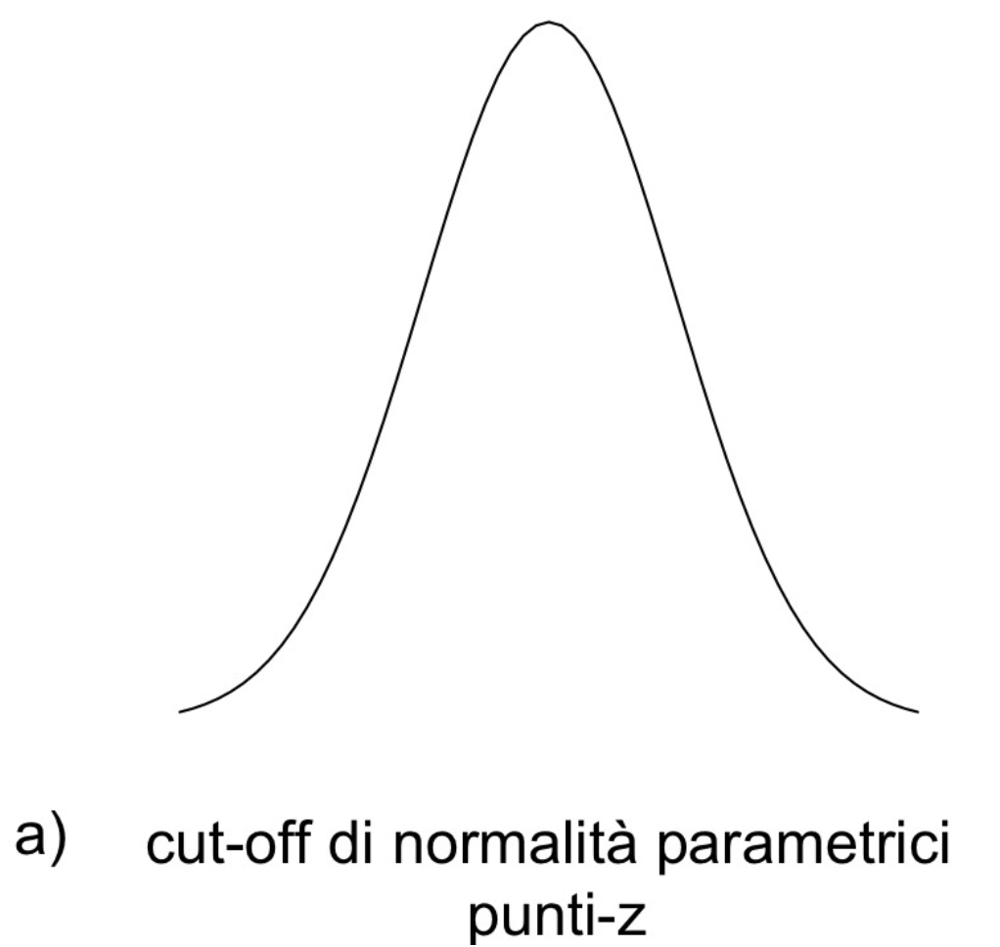{width="90%"}

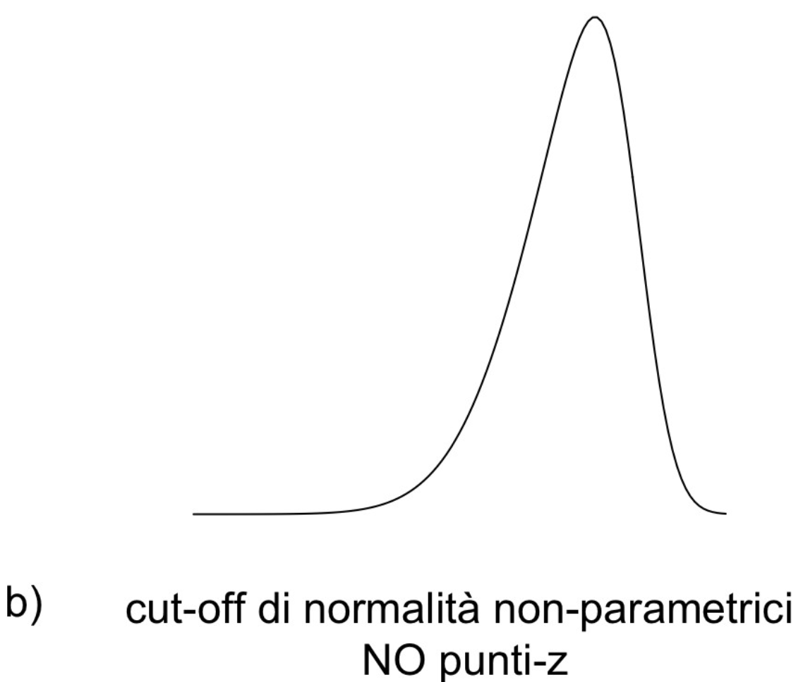{width="90%"}

Distribuzione normale e non normale: con la seconda i cut-off basati sui punti z non sono appropriati.
:::

Se si usano i punti z con distribuzioni non normali, la corrispondenza tra specifici punti z e
percentuali può non essere rispettata: per esempio $-1.64$ può non corrispondere al valore che
delimita il 5% dei punteggi più bassi, e si finisce per calcolare cut-off sbagliati.

Una precisazione importante: standardizzare (trasformare in punti z) a volte viene detto anche
"normalizzare", ma **non rende la distribuzione normale**. La trasformazione cambia la scala (media 0
e deviazione standard 1), non la forma della distribuzione.

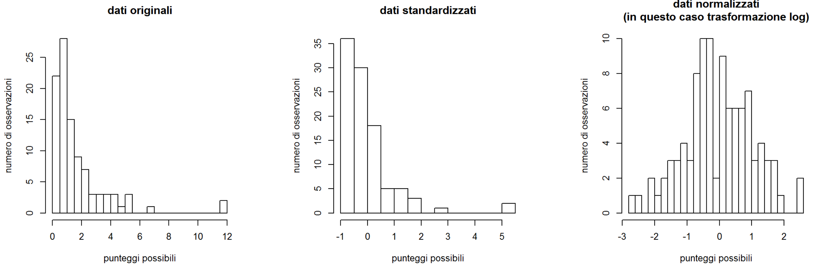{width="90%" fig-align="center"}

Nel caso di distribuzioni non normali il metodo più diffuso per calcolare i cut-off sono i
**percentili non parametrici**, che si ricavano direttamente dall'ordinamento dei punteggi osservati.
Lo svantaggio è che non esistono formule rapide per ricavare cut-off a percentuali diverse (per
esempio il 20% dei punteggi peggiori): bisogna avere a disposizione tutti i dati. Il codice R associato
al corso mostra esempi del potenziale impatto della non normalità, specie con un marcato effetto
soffitto.

# La distribuzione di riferimento

Finora abbiamo glissato su un punto critico: i valori soglia sono sempre **relativi a una
distribuzione di riferimento**. La definizione si può quindi precisare così:

$$
\text{definiamo } x \text{ in modo tale che } P(o < x \mid N) \leq k
$$

dove $N$ indica che la persona proviene dalla popolazione di persone "sane", cioè senza deficit
cognitivo. $x$ è dunque il valore per cui ci si attende una probabilità al massimo pari a $k$ di
osservare un punteggio inferiore, *assumendo* che la persona appartenga a questa popolazione. Se la
persona provenisse da un'altra popolazione (per esempio pazienti con malattia di Alzheimer), i valori
attesi potrebbero essere diversi.

## Analogia con il test d'ipotesi

Questa formulazione è del tutto analoga a quella del p-value rispetto all'ipotesi nulla, e
all'identificazione dei valori critici di una statistica test. Il valore critico è un **quantile della
distribuzione della statistica sotto l'ipotesi nulla**. Per un test a una coda inferiore:

$$
P(T \leq t_{crit} \mid H_0) = \alpha
$$

Se il valore osservato soddisfa $t_{obs} \leq t_{crit}$, il risultato cade nella **regione critica** e
si rifiuta $H_0$. Il p-value è invece la probabilità, assumendo vera $H_0$, di ottenere un valore
almeno altrettanto estremo di quello osservato:

$$
p = P(T \leq t_{obs} \mid H_0)
$$

Nel t-test per due campioni indipendenti, per esempio, l'ipotesi nulla è in genere
$H_0: \mu_1 = \mu_2$. La distribuzione di $T$, e quindi il valore critico, dipendono anche dai gradi
di libertà. Il parallelo con il cut-off è diretto: la condizione "$\mid N$" svolge il ruolo di
"$\mid H_0$", e la soglia del 5% il ruolo di $\alpha$.

# Campione o popolazione?

Facciamo un esperimento mentale. Supponiamo di avere dei dati normativi e di sapere che il punteggio
che corrisponde a $z = -1.64$ (5%), oppure il quinto percentile, è 4. Osserviamo una prestazione di 3:
la considereremmo deficitaria? E se sapessimo che la soglia è stata calcolata su un campione di 20
persone, oppure di 200, ci fideremmo allo stesso modo?

Considerare una soglia per inferenze cliniche non può prescindere da una riflessione su quanto il
campione sia **rappresentativo della popolazione** e su quanto i risultati siano generalizzabili.
Sebbene i percentili si possano calcolare sia sul campione sia sulla popolazione, nella valutazione
neuropsicologica l'interesse è sempre, implicitamente, per la popolazione: non ci interessa
classificare il paziente rispetto ai nostri specifici 10, 100 o 1000 soggetti sani, ma capire come si
classificherebbe rispetto alla popolazione dei sani. Detto altrimenti, la classificazione non dovrebbe
dipendere dallo specifico campione normativo, ma valere per tutti i possibili campioni normativi.
Questo conta soprattutto quando il campione è piccolo, e quindi poco rappresentativo della
popolazione.

## Percentile o probabilità?

Il percentile, di per sé, non dice nulla di probabilità: indica il valore che delimita una certa
percentuale di osservazioni *del campione*. Avere una percentuale non significa necessariamente
controllare la probabilità di errore. Percentili e punti z approssimano probabilità riferite alla
popolazione solo quando i campioni sono grandi e gli assunti sono rispettati (per esempio, la
normalità della distribuzione nella popolazione).

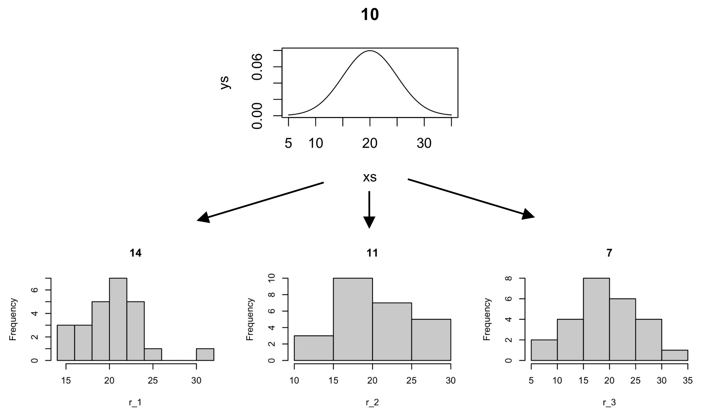{width="55%" fig-align="center"}

Una soglia calcolata sul 5% del campione (per esempio con i punti z) non garantisce dunque di
delimitare il 5% nella popolazione. Possiamo però stimare il valore della popolazione a partire dal
campione, accettando un certo margine di errore: è proprio quello che fa la **statistica
inferenziale**, la branca della statistica che permette di fare inferenze sulla popolazione a partire
dai dati di un campione, associando a queste inferenze una probabilità di errore nota. Una statistica
inferenziale permette enunciati precisi sulla probabilità di errore riferiti alla popolazione da cui è
estratto il campione, non al campione stesso. Non usare un test statistico per fare un'inferenza può
quindi essere visto come una strategia qualitativa e meno robusta, perché non sono note né la
probabilità di errore né la generalizzabilità dei risultati oltre il campione usato per il confronto.

In concreto, se si calcola il cut-off con la soglia $-1.64$ del punteggio standardizzato: (1) non si sa
quanto la classificazione si generalizzerebbe ad altri campioni; (2) non si conosce la probabilità di
errore della classificazione (assumendo che la persona sia sana), immaginando infinite ripetizioni.

## I limiti dello z-test

Usare il confronto con i punti z come test statistico corrisponde al cosiddetto **test z**, che però
assume di confrontare una *media campionaria* con una popolazione di riferimento e di conoscere la
*varianza della popolazione*, non quella del campione. Con varianza non nota si dovrebbe usare il
t-test (la distribuzione t si avvicina alla normale per campioni grandi). Usare i punti z per
classificare un individuo implica quindi due errori: si tratta il singolo individuo come se fosse una
media campionaria, e si trattano i dati normativi (che sono un campione) come se fossero la
popolazione. Al di là della correttezza formale, questo cambia la probabilità di errore di
classificazione, che in assenza di una statistica appropriata resta ignota.

Una nota confortante: con campioni sufficientemente ampi (più di 100 soggetti), una distribuzione
realmente normale e una deviazione standard non troppo elevata, gli errori non sono drammatici. È una
considerazione da prendere *cum grano salis*, basata sulle simulazioni dello script R associato.

# Il t-test di Crawford e Howell

Alcuni metodi tengono conto della differenza tra campione e popolazione e forniscono cut-off che sono
una **stima di quelli che si osserverebbero nella popolazione**. Questi cut-off sono spesso più bassi,
cioè meno restrittivi, di quelli calcolati direttamente sul campione. Il metodo di Crawford
[@crawford1998comparing; @crawford2006comparing] e il metodo dei Punteggi Equivalenti tengono conto di
questa differenza e sono da considerarsi più corretti.

Il t-test di @crawford1998comparing è una modifica del t-test che permette di confrontare un caso
singolo con un campione, ma con inferenza rispetto alla popolazione e con errore noto. Il test
funziona anche con campioni piccoli (circa 10 soggetti). In realtà il test risale a
@sokal1995biometry: Crawford e Howell hanno avuto il merito di diffonderlo per lo studio del caso
singolo in neuropsicologia.

::: {.callout-tip}
## Definizione: t-test di Crawford e Howell

$$
t = \frac{X_i - \bar{X}_2}{s_2\sqrt{\frac{N_2+1}{N_2}}}
$$

dove $X_i$ è il punteggio dell'individuo da valutare, $\bar{X}_2$ la media del campione normativo,
$s_2$ la deviazione standard del campione normativo e $N_2$ la sua numerosità. Il valore di $t$ si
confronta con una distribuzione t con $N_2 - 1$ gradi di libertà, ottenendo la probabilità (assumendo
vera l'ipotesi nulla) di osservare valori di $t$ uguali o inferiori a quello osservato.
:::

Il t-test di Crawford si comporta in modo più appropriato dello z-test e dei percentili non
parametrici, ed è anche più robusto alla violazione della normalità: anche se uno degli assunti è
violato, il comportamento del test resta tutto sommato adeguato. In particolare, mantiene un errore di
I tipo costante al 5% anche con campioni molto piccoli (n = 5). In concreto: se una persona proviene
davvero dalla popolazione dei sani, otterrà un valore "sotto cut-off" il 5% delle volte, proprio come
atteso; con i punti z la percentuale potrebbe essere del 10% o più. Questo suggerisce un potenziale
uso anche con campioni raccolti ad hoc, purché siano disponibili evidenze di affidabilità e validità.

Questo **non significa che bastino campioni piccoli**: è sempre meglio avere campioni numerosi, perché
portano a cut-off più vicini a quelli reali della popolazione (si veda la simulazione nello script
`11_C&H_test`).

# Il campione normativo di riferimento

Il test di Crawford, così come i punti z e i percentili, richiede di individuare un campione di
riferimento. I dati dovrebbero provenire da persone sane *simili* alla persona valutata. Ma come si
definisce questa somiglianza? Spesso, per il confronto normativo, ci si riferisce a persone dello
stesso sesso e con età e scolarità simili. La scelta è pragmatica: sono variabili che sappiamo
influenzare la prestazione cognitiva e che sono facili da raccogliere quando il test viene costruito.

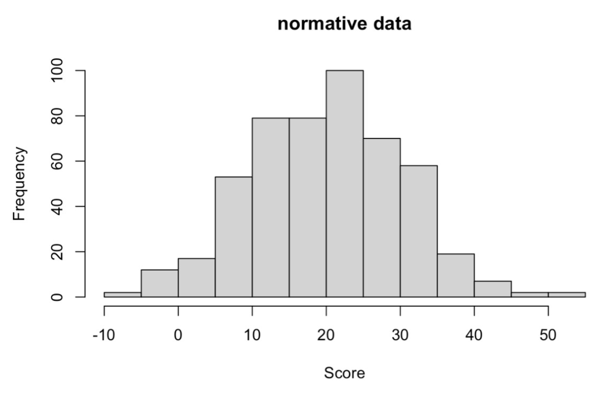{width="40%" fig-align="center"}

Finora abbiamo fatto riferimento a formule che confrontano la persona con **un singolo gruppo** di
dati, il "campione normativo". Questo gruppo è composto da individui con una certa età, una certa
scolarità e così via, e deve essere simile all'individuo da valutare. Ma come stabilire se è
abbastanza *simile*? Se il paziente ha 68 anni e 5 anni di scolarità (come GH, il caso che
riprenderemo alla fine), è adeguato un gruppo di persone tra 65 e 75 anni con scolarità tra 3 e 5
anni? Oppure servono persone con esattamente 68 anni ed esattamente 5 anni di scolarità? In genere i
test riportano tabelle predefinite, alcune combinazioni possono essere poco rappresentate nei dati
raccolti, e spesso non si ha accesso ai dati completi per "comporre" il gruppo di riferimento: bisogna
basarsi sulle tabelle disponibili.

È un aspetto metodologico importante e con conseguenze concrete. Se il campione di riferimento
contiene persone non simili a quella valutata, le inferenze su deficit o peggioramento risultano
distorte. Supponiamo che un test fornisca un cut-off per la fascia 70–80 anni e di dover valutare un
paziente di 70 anni: nella distribuzione di riferimento ci saranno anche persone di 80 anni, la cui
prestazione potrebbe essere molto più bassa. **La stratificazione arbitraria in fasce per le variabili
rilevanti (età, scolarità, sesso) pone sempre problemi sulla composizione del campione normativo e su
quanto sia davvero *simile* alla persona da valutare.**

## Fasce o regressioni

I metodi "di base" (punti z, percentili, t di Crawford) **dividono il campione** in sotto-campioni e
calcolano un cut-off per ciascuno: valori separati per diverse combinazioni di età e scolarità, divise
in fasce, oppure, più raramente, tabelle di correzione o singole correzioni (per esempio "+2 per
scolarità $\leq$ 8"). I metodi basati sulle **regressioni** non suddividono il campione, ma modellano
l'effetto di età, scolarità (e sesso). In genere forniscono un singolo cut-off con tabelle di
correzione, un singolo cut-off con formule per calcolare la correzione, oppure tabelle con diversi
cut-off per le varie combinazioni di età, scolarità e sesso.

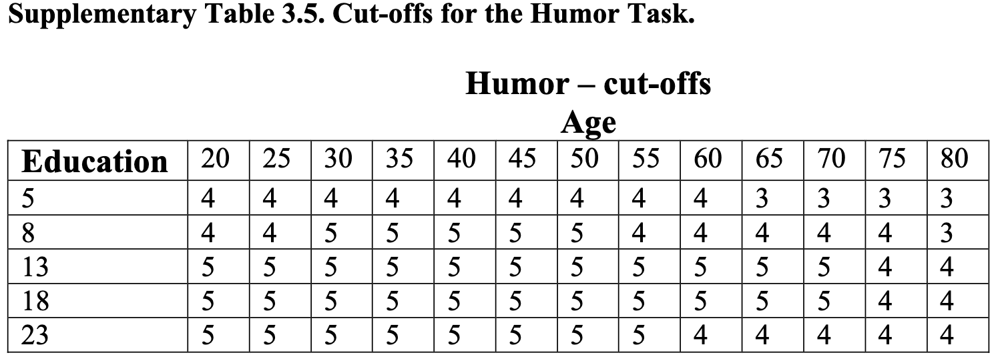{width="60%" fig-align="center"}

Quando invece vengono fornite le formule, queste possono risultare di fatto incomprensibili per chi
le deve applicare. Un esempio è la formula per la deviazione standard della differenza tra punteggio
osservato e punteggio previsto da una regressione con età e scolarità:

$$
sd_{Y_i-\hat{Y}_i} = \frac{SE_{Y-\hat{Y}}}{\sqrt{n}}\sqrt{n+1+\frac{z_{i,age}^2}{1-R_{age}^2}+\frac{z_{i,education}^2}{1-R_{education}^2}-2\frac{\beta_{education,age}\,z_{i,age}\,z_{i,education}}{1-R_{education}^2}}
$$

# Metodi di regressione

In alternativa ai metodi che usano un semplice campione di riferimento esistono metodi basati sulla
regressione, che hanno il vantaggio di **non stratificare arbitrariamente in fasce**. Ne sono esempi
il metodo dei Punteggi Equivalenti e alcuni metodi di Crawford [@crawford2006comparing]. Il razionale
è il seguente: (1) a partire da alcune variabili si può prevedere, con un modello di regressione
lineare, la prestazione attesa della persona dati i valori osservati di quelle variabili; (2) una volta
ottenuto il modello, si stabilisce se la prestazione osservata è sufficientemente improbabile dati
quei valori.

::: {.callout-tip}
## Definizione: cut-off con metodi di regressione

Il cut-off $x$ è il punteggio per cui, per la persona $i$ con specifici valori delle variabili
aggiuntive $V1, V2, \dots, Vn$, la probabilità di osservare una prestazione inferiore è al massimo $k$
(normalmente 0.05):

$$
\text{definiamo } x \text{ in modo tale che } P(o_i < x \mid V1_i, V2_i, \dots, Vn_i, N) \leq k
$$

dove l'indice $i$ indica una specifica combinazione di valori delle variabili che possono influenzare
la prestazione. Classicamente i modelli includono età, scolarità e sesso come predittori.
:::

Quali variabili includere nella regressione? Esistono molti modi per selezionarle, e approfondirli va
oltre gli scopi del corso. I metodi più raffinati tengono conto anche di eventuali non linearità, cioè
relazioni tra predittori e punteggio descrivibili con funzioni non lineari (per esempio esponenziali
o iperboliche).

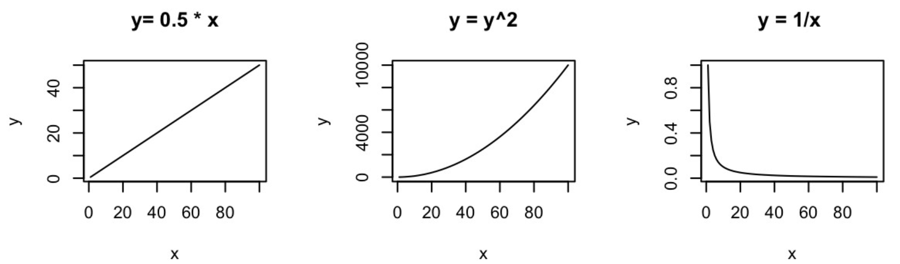{width="55%" fig-align="center"}

![Esempio di modello di regressione per i dati normativi, dal Tele-GEMS [@montemurro2023telegems].](../Figures/tele_gems.png){width="95%" fig-align="center"}

# I Punteggi Equivalenti

Il metodo dei Punteggi Equivalenti (PE) è il metodo basato su regressioni alla base della maggior
parte dei test neuropsicologici sviluppati in italiano. È stato introdotto da Erminio Capitani nella
raccolta di tarature di test curata da Spinnler e Tognoni [@spinnler1987standardizzazione; si vedano
anche @capitani1988aging; @capitani1997composite]. Ha tre caratteristiche chiave: corregge per età e
scolarità tramite regressioni; tiene conto della differenza tra campione e popolazione; permette il
confronto tra test diversi. Il calcolo si articola in tre passi.

**Passo 1: punteggi aggiustati.** Si calcolano punteggi da cui è rimosso l'effetto di età e
scolarità (ed eventualmente sesso). La distribuzione dei punteggi grezzi include persone di età
diverse, e l'età ha un effetto sul punteggio che si può descrivere con una retta di regressione.

::: {#fig-pe-passo1 layout-ncol=2}
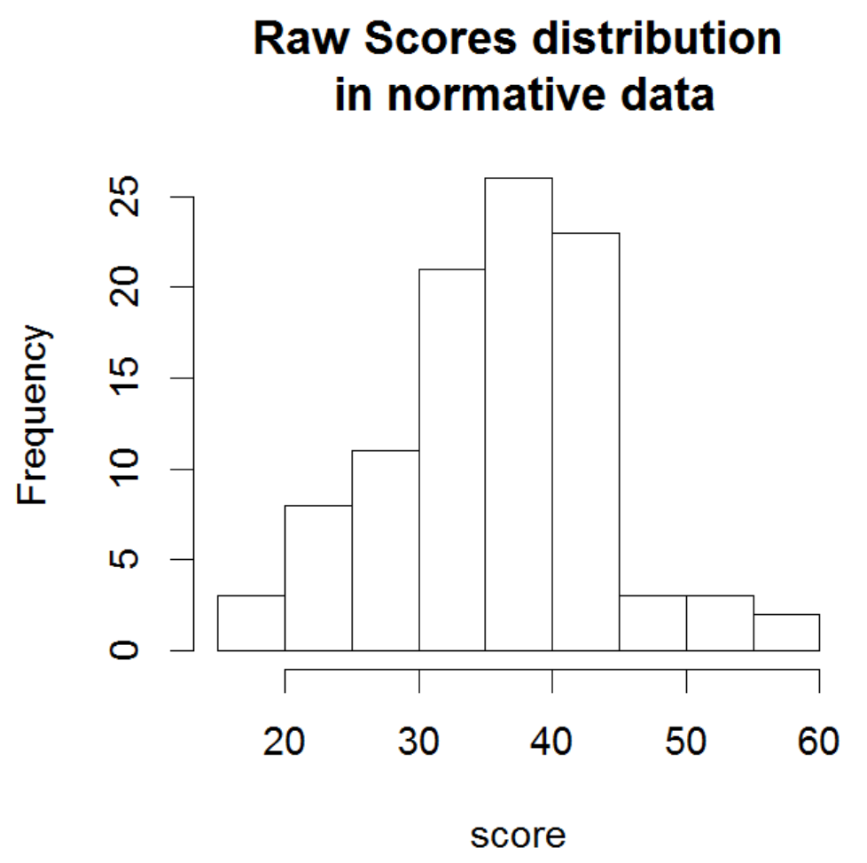{width="95%"}

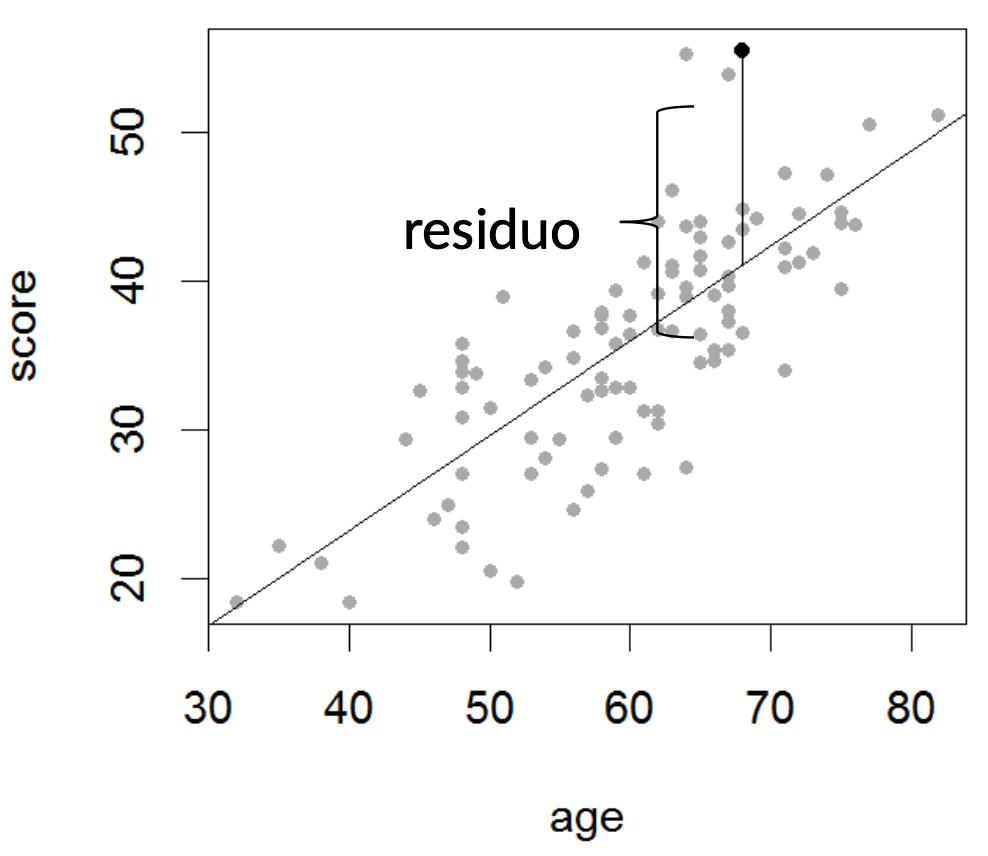{width="95%"}

Primo passo dei Punteggi Equivalenti: per ogni persona del campione normativo la differenza tra punteggio osservato e punteggio previsto dalla regressione è il residuo.
:::

Per ogni persona del campione normativo si calcola il **residuo**, cioè la differenza tra il punteggio
osservato e quello previsto dalla regressione. I residui potrebbero già essere considerati punteggi
"aggiustati", perché sono ciò che rimane del punteggio una volta tolta l'influenza dei predittori (in
questo esempio, l'effetto dell'età). Nel metodo dei PE i punteggi aggiustati sono riportati su una
scala simile a quella originale, aggiungendo al residuo l'intercetta.

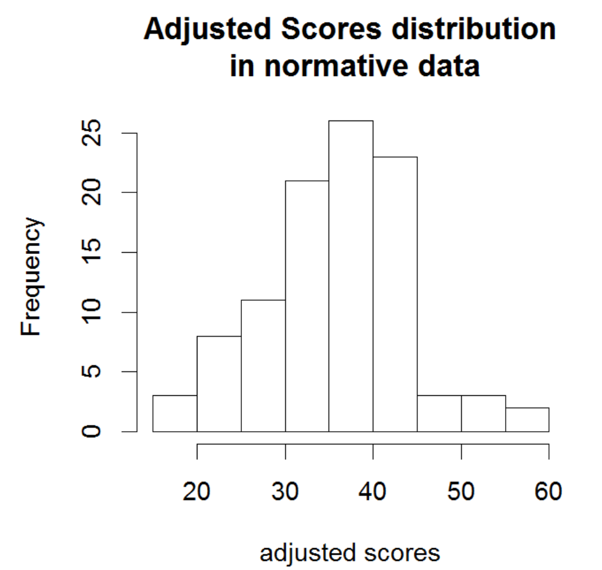{width="45%" fig-align="center"}

**Passo 2: limite di tolleranza (PE = 0).** Sulla distribuzione dei punteggi aggiustati si calcola il
PE = 0 come **limite di tolleranza interno unidirezionale non parametrico al 5%**: è il punteggio che
non verrà ottenuto da più del 5% della popolazione, cioè il cut-off *a livello di popolazione*.

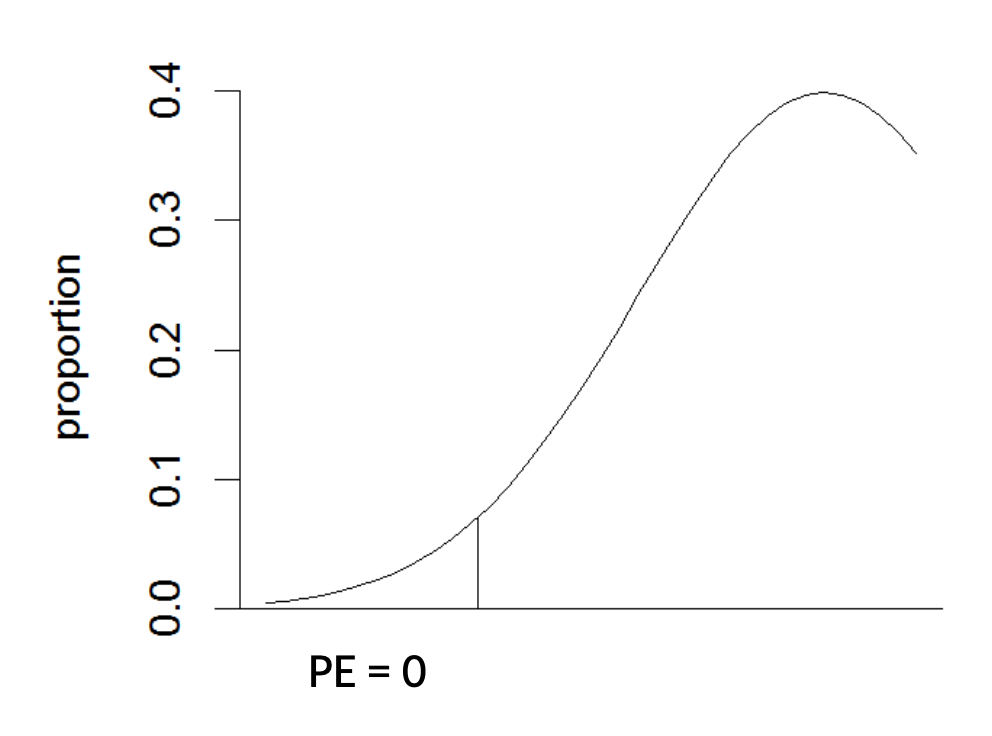{width="45%" fig-align="center"}

**Passo 3: gli altri PE.** In riferimento all'ipotetica distribuzione dell'abilità sottostante si
individua anche il PE = 4, e si divide lo spazio tra PE = 0 e PE = 4 in intervalli equispaziati
(rispetto all'abilità sottostante).

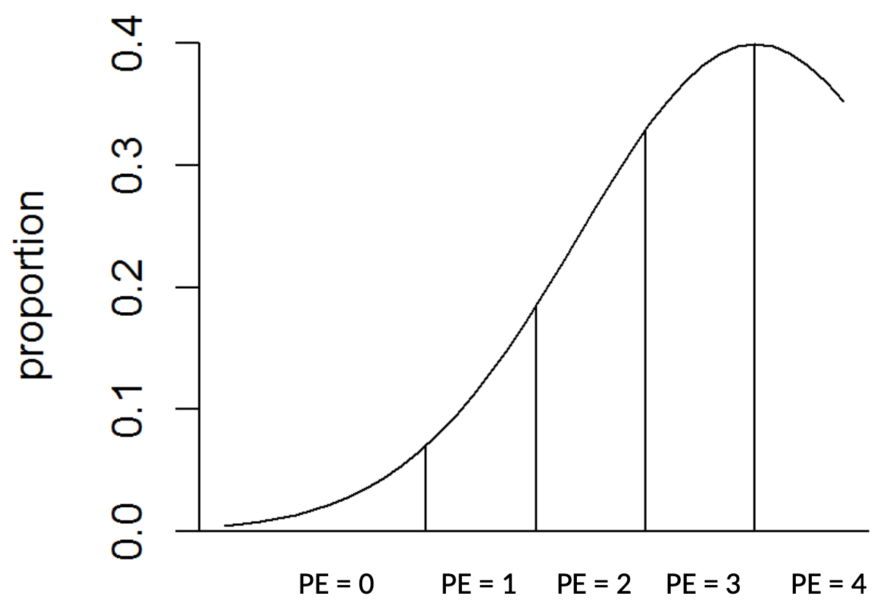{width="45%" fig-align="center"}

**Uso pratico.** Per una nuova persona si calcola il punteggio aggiustato, consultando la tabella di
correzione o applicando la formula di regressione, e lo si confronta con la tabella di
corrispondenza tra punteggio aggiustato e Punteggio Equivalente. I risultati che coincidono con il
punteggio massimo o minimo non si correggono. **Se il punteggio corretto è inferiore alla soglia del
PE = 0, la prestazione è deficitaria.** A lezione si prova insieme un utilizzo ipotetico dei PE a
partire da un articolo di taratura.

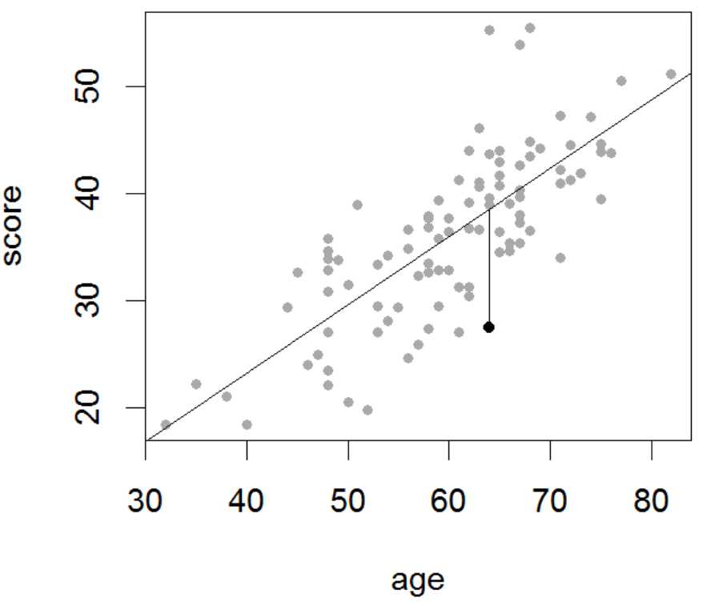{width="45%" fig-align="center"}

# Limiti dei metodi di regressione

I metodi di regressione possono sembrare la soluzione perfetta ai problemi dei metodi più semplici di
confronto con i dati normativi (come il t-test di Crawford): in particolare **evitano i gradini
arbitrari** delle fasce e permettono una stima più corretta per la singola persona. Non sono però
privi di problemi: una stima non corretta del modello di regressione può portare a punteggi finali
distorti.

Le distorsioni sono attese soprattutto per valori estremi dei predittori, per esempio scolarità o età
molto alte o molto basse: sono i punti in cui eventuali imprecisioni del modello hanno effetti più
accentuati. Inoltre i modelli di regressione possono dare l'illusione di buone predizioni in zone dello
spazio dei valori in cui in realtà ci sono poche osservazioni e stime imprecise. Supponiamo di avere
dati normativi di 1000 soggetti analizzati con un metodo di regressione e di dover valutare una persona
particolare, per esempio una donna di 80 anni con 23 anni di scolarità. È possibile che nel campione ci
siano pochissime persone con questa combinazione di valori, o nessuna: in quel caso si parla di
*estrapolazione*. Sarebbe più opportuno avere un piccolo campione (anche di 15 persone) davvero
*simile* all'individuo da valutare e un test appropriato, come il t-test di Crawford.

# Errori di I e II tipo

In generale, i metodi che tengono conto della differenza tra campione e popolazione sono preferibili.
Il t-test di Crawford (e i metodi di regressione di Crawford) sono in grado di mantenere l'errore di I
tipo, cioè la probabilità che una persona sana risulti sotto cut-off, al livello atteso (0.05, cioè il
5%) su un numero elevato (in teoria infinito) di ripetizioni.

Esiste però anche l'errore di II tipo: non riuscire a identificare correttamente una persona con
deficit. Per i test usati per deficit e peggioramento è difficile da calcolare, perché non sappiamo
quale sia la prestazione attesa da chi ha un deficit o un peggioramento (si veda la figura del cut-off
clinico all'inizio). Per calcolare l'errore di II tipo si studiano in genere diversi scenari
**ipotetici**, con diversi livelli di gravità del deficit. Nei test neuropsicologici questo però non
viene praticamente mai fatto: ci si concentra solo sul cut-off e sull'errore di I tipo.

Infine, errori di I e II tipo non si riferiscono a uno specifico campione, ma a **infiniti** campioni.
Le simulazioni mostrano quanto la stima del cut-off sia più variabile con campioni piccoli: anche per
questo sarebbe sempre desiderabile, dove possibile, avere campioni ampi.

## Che fine hanno fatto affidabilità e validità?

Per convenzione, nel calcolo dei valori soglia affidabilità e validità spesso non vengono considerate.
È un problema, perché test con affidabilità diversa vengono trattati allo stesso modo. Affidabilità,
validità e cut-off (o trasformazioni in percentili) vengono quindi combinati solo nell'interpretazione
dei risultati, e non tramite formule che li considerino insieme.

# Torniamo al caso GH

::: {.callout-note}
## Il caso GH

GH è un uomo di 68 anni, vedovo, al centro di un contenzioso con una compagnia di assicurazione. Al
momento critico della valutazione ha appena avuto un trauma cranico in seguito a un piccolo incidente
stradale, in cui ha battuto la testa e perso conoscenza. L'unico figlio sostiene che, come
conseguenza, il padre ha avuto un importante peggioramento del funzionamento cognitivo, che si
manifesta nell'incapacità di comprendere bene ciò che gli viene detto. Nell'anamnesi c'è però un
evento rilevante: a 30 anni, sistemando il tetto di un garage, GH è caduto da una scala e ha battuto la
testa. In ospedale non gli è stato diagnosticato un trauma cranico, ma poco dopo ha perso il lavoro
che aveva da tempo in una piccola azienda e ha divorziato dalla moglie. I consulenti
dell'assicurazione sostengono che il problema di GH sia legato al trauma cranico di molti anni prima,
e non all'incidente stradale; i consulenti di GH sostengono invece che il danno sia riconducibile solo
al trauma più recente.
:::

Supponiamo di usare il test Linguaggio Figurato 1 della batteria APACS [@arcara2016apacs], con
validità e affidabilità comprovate e che misura la capacità di comprendere il linguaggio figurato. Il
test ha una consistenza interna sufficiente (0.65), una buona affidabilità test-retest a un mese
($r = 0.94$) e un basso effetto pratica; ci sono alcune evidenze di validità di costrutto (da analisi
fattoriale) e una buona validità di contenuto, basata sulla valutazione di alcuni esperti.

Il cut-off per una persona di 68 anni con 5 anni di scolarità è 12. Poiché il metodo usato da APACS per
i cut-off tiene conto della distinzione tra campione e popolazione, un punteggio inferiore al cut-off è
atteso in meno del 5% della popolazione dei sani. Se GH ottenesse meno di 12 potremmo concludere che la
sua prestazione è insolita *se fosse sano*, ma non potremmo dire se si tratta di un deficit
preesistente o di un peggioramento legato al trauma cranico: i metodi per inferire un deficit o un
peggioramento sono analoghi. Consultando le tabelle di APACS si vede inoltre che 40 persone del
campione di sani rientrano nella fascia di età e scolarità di GH: le stime sono quindi abbastanza
solide.

# In sintesi {.unnumbered}

Siamo partiti dal problema di definire deficit e peggioramento. Il metodo più diffuso si basa
sull'improbabilità di osservare una certa prestazione *se si è sani*: un ragionamento contorto, ma
necessario. Spesso serve una soglia, e la si fissa arbitrariamente al 5% delle prestazioni più basse;
entrambe le scelte ricordano il rifiuto dell'ipotesi nulla nei test statistici.

Il problema è cosa si intenda per "5%": non ha senso riferirsi alla distribuzione del campione, ma alla
popolazione. Tra i vari metodi per calcolare soglie e probabilità sarebbe meglio: (a) usare quelli che
tengono effettivamente conto della distinzione tra campione e popolazione; (b) avere campioni numerosi
(almeno n > 100); (c) non usare indiscriminatamente i punti z se la distribuzione dei punteggi non è
nota. Anche con metodi non ottimali, avere campioni ampi migliora le stime.

I metodi basati su sotto-campioni hanno il problema dei "gradini" che nascono quando una variabile
continua, come l'età, viene trasformata in fasce. I metodi di regressione risolvono questo problema, ma
bisogna fare attenzione a quanto il campione sia davvero *simile* alla persona (combinazioni rare di
età e scolarità) e ai valori estremi dei predittori, dove la stima può essere più imprecisa.

# Riferimenti {.unnumbered}

::: {#refs}
:::
