::: {.callout-note}
## Nota sull'uso dell'intelligenza artificiale

Questo handout è stato generato con l'assistenza di **Claude** (Anthropic), un modello di
intelligenza artificiale, a partire dalle slide della lezione 5 (*Identificare condizioni di
interesse – Teoria e Formule*) e usando come riferimento il libro del corso, *Oltre i punteggi*
[@arcara2025oip]. Al modello è stato chiesto di riscrivere in forma discorsiva il contenuto delle
slide, integrandone le figure, **senza aggiungere nuovo materiale**. Il testo può comunque contenere
imprecisioni: in caso di dubbio fanno fede le slide, il libro e quanto detto a lezione.

Materiale distribuito con licenza Creative Commons Attribuzione – Non commerciale 4.0 Internazionale
(CC BY-NC 4.0, <https://creativecommons.org/licenses/by-nc/4.0/deed.it>).
:::

# Dal cut-off di normalità alla condizione di interesse

## Breve riepilogo

Nelle lezioni precedenti abbiamo visto la metodologia usata per identificare un deficit (o un
peggioramento) cognitivo. Data la difficoltà metodologica ed epistemologica di definire deficit e
peggioramento, si usa un ragionamento inverso: si parte da una definizione di *assenza di deficit* e,
per definire i valori soglia (**cut-off di normalità**), si usano solo dati di persone senza deficit.
Non sapendo dove si collocano i punteggi di una popolazione patologica, la soglia corrisponde,
arbitrariamente, al punteggio che delimita il 5% più basso delle prestazioni dei sani, assumendo che
deficit e patologia siano associati a prestazioni peggiori.

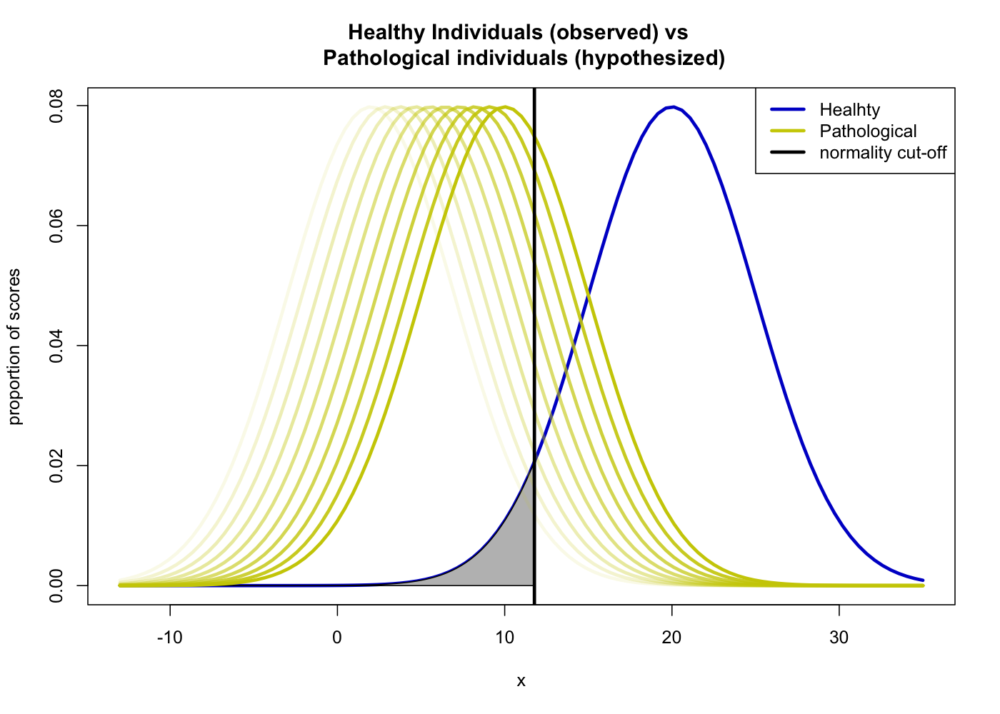{width="50%" fig-align="center"}

## Percentuali e probabilità

In questa lezione si parlerà spesso di *percentuali basate su campioni* (per esempio i percentili) e
di *probabilità*, che non sono necessariamente la stessa cosa. Spesso usiamo percentuali ottenute su
campioni per **stimare** probabilità, ma le probabilità sono le percentuali che ci attenderemmo se
avessimo accesso all'intera *popolazione*. Un altro modo di vedere la differenza è che percentili e
percentuali si riferiscono al passato (a ciò che è stato osservato), mentre le probabilità si
riferiscono a ciò che ci attenderemmo *nel futuro*. In termini più tecnici, la probabilità è la
percentuale attesa se potessimo ripetere infinite volte il campionamento.

## La condizione di interesse e il gold standard

Esistono situazioni in cui è possibile identificare la *condizione di interesse* (in inglese
*Condition of Interest*, COI) tramite procedure, magari costose o invasive, che forniscono una
classificazione che consideriamo il nostro riferimento di correttezza.

::: {.callout-tip}
## Definizione: condizione di interesse e gold standard

La **condizione di interesse** è, in contesto clinico, spesso la presenza di una patologia, oppure la
classificazione ottenuta con un test costoso. In ambito forense anche l'essere classificati come
"potenziale simulatore" è una condizione di interesse. Il test, metodo o procedura diagnostica usato
per ottenere la classificazione di riferimento si chiama **gold standard**.
:::

Quando è possibile distinguere due categorie (si possono immaginare anche casi con tre o più
categorie, ma spesso vengono ricondotti a confronti tra due), l'obiettivo del test diventa
identificare una soglia che permetta di discriminare correttamente tra le due categorie, in accordo
con il gold standard. Per distinguerla dal cut-off di normalità, chiameremo questa soglia **cut-off di
discriminazione**.

Negli esempi che seguono useremo spesso, per semplicità, "soggetto patologico" per indicare che la
condizione di interesse è presente; tutti i ragionamenti si estendono ad altre condizioni di
interesse. Vedremo prima le classificazioni che si ottengono *dopo* aver fissato la soglia, e poi come
si sceglie la soglia.

::: {#fig-cutoff layout-ncol=2}
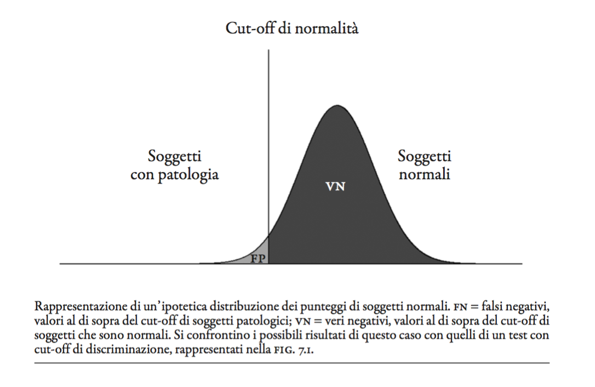{width="95%"}

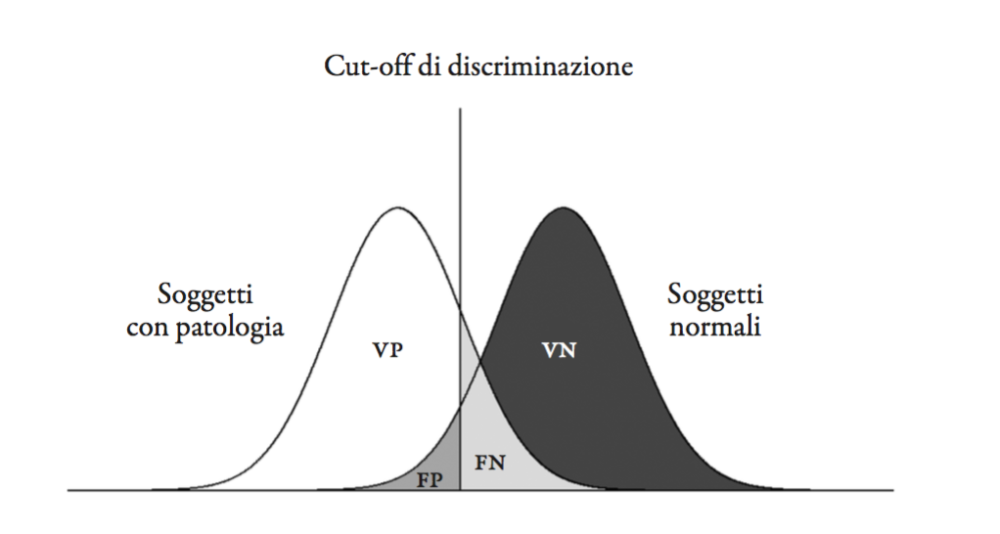{width="95%"}

Cut-off di normalità (definito solo dalla distribuzione dei sani) e cut-off di discriminazione (definito considerando entrambe le distribuzioni, con e senza la condizione di interesse).
:::

# La matrice di confusione

Confrontando la classificazione del test con quella del gold standard si ottengono quattro possibili
esiti:

- **VP**, *vero positivo*: soggetto patologico correttamente identificato come patologico;
- **FP**, *falso positivo*: soggetto sano erroneamente identificato come patologico;
- **FN**, *falso negativo*: soggetto patologico erroneamente identificato come sano;
- **VN**, *vero negativo*: soggetto sano correttamente identificato come sano.

Questi esiti si riportano spesso in una tabella nota come **matrice di confusione**.

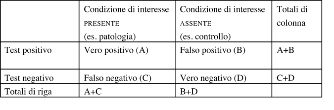{width="75%" fig-align="center"}

# Sensibilità e specificità

A partire dalla matrice di confusione si calcolano due misure fondamentali.

::: {.callout-tip}
## Definizione: sensibilità e specificità

$$
\text{Sensibilità} = \frac{VP}{VP + FN}
\qquad\qquad
\text{Specificità} = \frac{VN}{VN + FP}
$$

La **sensibilità** (in inglese anche *recall*) è la stima della probabilità di identificare
correttamente un caso positivo, se la persona è positiva al gold standard. La **specificità** è la
stima della probabilità di identificare correttamente un caso negativo, se la persona è negativa al
gold standard.
:::

In un esempio neuropsicologico, la sensibilità è la probabilità stimata di identificare correttamente
una persona con demenza, se la persona ha la demenza secondo il gold standard; la specificità è la
probabilità stimata di identificare correttamente una persona sana (senza demenza) secondo il gold
standard. In un esempio forense, la sensibilità è la probabilità di identificare correttamente un
simulatore, se la persona è un simulatore secondo il gold standard; la specificità è la probabilità di
identificare correttamente un non simulatore, se la persona non è un simulatore secondo il gold
standard.

Vale la pena chiedersi su quali dati si basano le due misure. La sensibilità usa solo la colonna della
matrice in cui la condizione di interesse è *presente* (VP e FN), quindi dipende solo dai risultati dei
soggetti patologici; la specificità usa solo la colonna in cui la condizione è *assente* (VN e FP),
quindi dipende solo dai risultati dei soggetti sani.

## Il cut-off di discriminazione e il compromesso tra le due misure

Anche se dipendono da campioni diversi, sensibilità e specificità sono interconnesse quando le
distribuzioni dei due gruppi (patologici e non) si sovrappongono. Idealmente un test dovrebbe avere sia
alta sensibilità sia alta specificità, ma spesso aumentare l'una va a scapito dell'altra.

Immaginiamo di spostare a sinistra o a destra la linea del cut-off di discriminazione: cambierebbero
tutte le classificazioni, VP, VN, FP e FN. Spostando la linea a sinistra (cioè abbassando il cut-off)
diminuiscono i FP, ma anche i VP, e aumentano VN e FN. Per esplorare in modo dinamico come la scelta
della soglia cambia la classificazione si può usare l'app
<https://app.hsancamillo.it/app/sens-spec>.

## Specificità e cut-off di normalità

È interessante notare che l'uso di un cut-off di normalità (si vedano le lezioni sul confronto con i
dati normativi) corrisponde a una situazione in cui **non conosciamo la distribuzione dei punteggi di
chi ha un deficit o un peggioramento**, ma sappiamo che verosimilmente sarà spostata verso punteggi
peggiori rispetto a quella di chi non li ha. Non sapendo dove mettere la soglia, la si colloca nel
punto che delimita il 5% del campione (o della popolazione) dei sani.

# La curva ROC e la soglia ottimale

I possibili valori di sensibilità e specificità al variare della soglia si studiano, e si
rappresentano graficamente, con la **curva ROC** (*Receiver Operating Characteristic*).

::: {.callout-tip}
## Definizione: curva ROC

Nella curva ROC sull'asse y si riporta in genere la *sensibilità* e sull'asse x *1 − specificità*.
Ogni punto della curva rappresenta la combinazione di sensibilità e specificità che si ottiene
scegliendo una specifica soglia.
:::

Una curva ROC ottimale si avvicina il più possibile all'angolo in alto a sinistra. Quanto più la curva
si avvicina alla diagonale, tanto più il test si comporta come un "classificatore casuale": qualunque
sia la soglia, classificare equivale a lanciare una moneta per decidere l'appartenenza a uno dei due
gruppi.

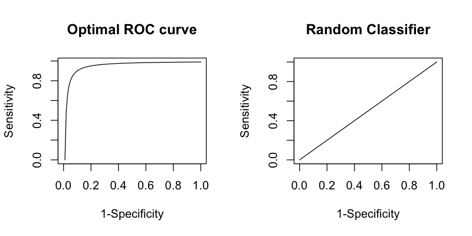{width="70%" fig-align="center"}

## Identificare la soglia ottimale

La soglia ottimale è spesso definita con indici che cercano un equilibrio tra sensibilità e
specificità. In genere è il punto più in alto a sinistra della curva, cioè quello con sensibilità e
specificità più alte, oppure il valore in cui la somma di sensibilità e specificità è massima. Questo
criterio corrisponde all'indice di Youden [@youden1950index].

::: {.callout-tip}
## Definizione: indice di Youden

$$
J = \text{Sensibilità} + \text{Specificità} - 1
$$
:::

Non di rado le soglie ottimali possono essere due: per esempio una soglia con sensibilità 0.92 e
specificità 0.93, e un'altra con sensibilità 0.93 e specificità 0.92. In questo caso l'indice $J$ è
identico, e la soglia si sceglie in base alle esigenze del test, privilegiando la sensibilità o la
specificità.

Più in generale, la soglia ottimale potrebbe non essere scelta su base statistica, ma in base al
rischio associato a una classificazione sbagliata. Per un test rapido per la demenza, a cui si intende
far sempre seguire una valutazione più estesa, potrebbe essere utile massimizzare la sensibilità a
scapito della specificità: si commetteranno più errori classificando come possibili pazienti con
demenza persone che non lo sono, ma è uno scenario preferibile all'opposto, cioè classificare come
sana una persona a rischio di demenza.

## Sovrapposizione delle distribuzioni

Quanto più le distribuzioni dei due gruppi sono separate, tanto migliori saranno sensibilità e
specificità: sarà possibile trovare un cut-off di discriminazione che discrimina bene. Se invece le
distribuzioni sono troppo sovrapposte, può essere impossibile ottenere sensibilità e specificità
soddisfacenti, qualunque sia la soglia scelta.

::: {#fig-overlap layout-ncol=2}
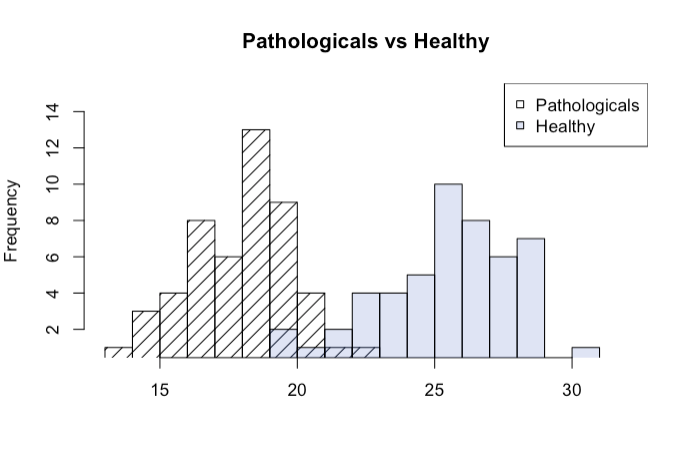{width="95%"}

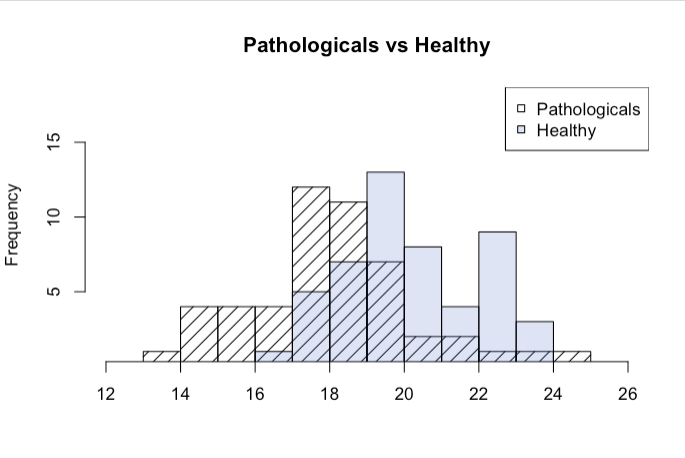{width="95%"}

Con distribuzioni ben separate esiste una soglia che discrimina bene; con distribuzioni molto sovrapposte nessuna soglia garantisce sensibilità e specificità soddisfacenti.
:::

Ne segue una differenza importante rispetto ai test basati su cut-off di normalità: per i test che
mirano a un cut-off di discriminazione **potrebbe non esistere una soglia adeguata**. Il problema non
si pone con il cut-off di normalità, perché lì si può sempre delimitare il 5% delle prestazioni
peggiori. In realtà non sappiamo dove si trovi la distribuzione di chi ha un deficit o un
peggioramento: abbiamo proprio *definito* come soglia del deficit quella del 5% delle prestazioni
peggiori.

# Proprietà del test, non della valutazione

Come per le altre proprietà studiate finora, sensibilità e specificità sono caratteristiche del test
(in determinate condizioni), non della specifica valutazione. L'esito della singola valutazione
dipende infatti dalla realtà della situazione, che non possiamo conoscere.

Parlare di probabilità può creare confusione, soprattutto quando, almeno in teoria, la verità esiste
già. Avrebbe senso parlare di probabilità riferendosi al futuro (per esempio, la probabilità di
sviluppare la malattia di Alzheimer entro 5 anni), ma spesso la realtà c'è già e semplicemente non la
conosciamo: non sappiamo se la persona sta sviluppando l'Alzheimer, ma c'è una risposta corretta, o ce
l'ha o non ce l'ha. Per questo non è corretto dire che "questo individuo ha il 90% di probabilità di
avere l'Alzheimer". Il test ci dice piuttosto che il 90% delle persone con Alzheimer ottiene una
prestazione di questo tipo. L'esempio è più chiaro con condizioni come la presenza di un tumore: o c'è
o non c'è, e lo si può stabilire con l'esame istologico, che fa da "verità".

## Condizioni di interesse e validità

Nei test per cui si possono valutare sensibilità e specificità, cioè quando c'è un gold standard,
l'interesse è in genere per la **validità di criterio** (si vedano le lezioni sulla validità). Ciò che
conta, infatti, non è tanto che cosa si stia misurando, ma l'efficacia della classificazione che quei
numeri producono. È però una riflessione delicata, perché un test poco valido è anche più esposto a
problemi, per esempio all'influenza sul punteggio finale di costrutti che non interessano.

# Dalle probabilità "al contrario" al teorema di Bayes

Sensibilità e specificità permettono di stimare due cose importanti:

- *assumendo che l'individuo sia davvero positivo*, qual è la probabilità che sia sotto soglia al test
  (sensibilità)?
- *assumendo che l'individuo sia davvero negativo*, qual è la probabilità che sia sopra soglia al test
  (specificità)?

Sono informazioni utili, ma hanno limiti analoghi a quelli del cut-off di normalità: costringono a un
ragionamento "al contrario", in cui si assume che cosa la persona sia e ci si chiede se risulterà
sotto soglia:

$$
P(\text{test sotto cut-off} \mid \text{patologico})
\qquad\qquad
P(\text{test sopra o uguale al cut-off} \mid \text{sano})
$$

Idealmente vorremmo la situazione opposta, cioè

$$
P(\text{patologico} \mid \text{test sotto cut-off})
$$

che però è molto più difficile da calcolare.

## Il teorema di Bayes

Il teorema di Bayes mette in relazione probabilità diverse, e chiarisce la differenza tra probabilità
che intuitivamente si potrebbero confondere:

$$
P(A \mid B) \neq P(B \mid A)
$$

cioè, nel nostro caso,

$$
P(\text{patologia} \mid \text{punteggio sotto cut-off}) \neq P(\text{punteggio sotto cut-off} \mid \text{patologia})
$$

Ci servirebbe la prima probabilità, ma abbiamo la seconda.

::: {.callout-tip}
## Definizione: teorema di Bayes

$$
P(A \mid B) = \frac{P(B \mid A)\,P(A)}{P(B)}
$$

o, con un esempio pratico,

$$
P(\text{patologia} \mid \text{sotto cut-off}) = \frac{P(\text{sotto cut-off} \mid \text{patologia})\,P(\text{patologia})}{P(\text{sotto cut-off})}
$$
:::

Al di là dell'aspetto matematico, il teorema di Bayes dice una cosa sostanziale: per calcolare la
probabilità che ci interessa davvero dovremmo conoscere altre probabilità che di fatto non potremo
mai conoscere con certezza, in particolare la **probabilità a priori**, legata alla *prevalenza* (si
vedano PPV e NPV più avanti). Per questo i test forniscono informazioni "indicative" sulla probabilità
di avere una malattia o una condizione di interesse. Spetta al neuropsicologo arrivare alla diagnosi,
anche discostandosi dal risultato di un test se ci sono elementi che suggeriscono che la probabilità a
priori (o *base rate*) possa alterare i valori. Il tema verrà approfondito nella lezione
sull'interpretazione.

# Valori predittivi positivo e negativo

Dalla matrice di confusione si ottengono altre due misure molto rilevanti.

::: {.callout-tip}
## Definizione: PPV e NPV

$$
PPV = \frac{VP}{VP + FP}
\qquad\qquad
NPV = \frac{VN}{VN + FN}
$$

Il **valore predittivo positivo** (*Positive Predictive Value*, PPV) è la proporzione di persone
realmente positive (al gold standard) tra tutte quelle che risultano positive al test. Il **valore
predittivo negativo** (*Negative Predictive Value*, NPV) è la proporzione di persone realmente
negative tra tutte quelle che risultano negative al test.
:::

Per esempio, in un test che dovrebbe distinguere persone con Alzheimer da persone sane, il PPV è la
proporzione di persone con Alzheimer (secondo il gold standard) tra tutte quelle che il test classifica
come Alzheimer; il NPV è la proporzione di persone sane tra tutte quelle che il test classifica come
sane.

Una domanda utile è: su quali campioni si basano PPV e NPV? A differenza di sensibilità e specificità,
che usano le colonne della matrice di confusione, PPV e NPV usano le *righe*, e quindi mescolano
soggetti con e senza la condizione di interesse. Come sensibilità e specificità, anche PPV e NPV si
riferiscono al test e a una specifica soglia: cambiando la soglia o altri parametri cambiano anche
loro. Con l'app <https://app.hsancamillo.it/app/sens-spec> si può provare a modificare anche la
numerosità dei due gruppi (patologici e sani) e osservare come cambiano sensibilità e specificità da un
lato, PPV e NPV dall'altro.

## PPV e teorema di Bayes

Il PPV è una stima diretta di $P(\text{patologico} \mid \text{test sotto cut-off})$ ed è quindi
direttamente legato al teorema di Bayes. Ha però senso solo se la proporzione tra sani e patologici
(cioè tra veri negativi e veri positivi) non è decisa dallo sperimentatore, ma riflette quella reale
della popolazione.

Con un po' di algebra, PPV e NPV si possono riscrivere in funzione di sensibilità, specificità e
prevalenza:

$$
PPV = \frac{\text{Sens} \times \text{Prev}}{(\text{Sens} \times \text{Prev}) + (1 - \text{Spec}) \times (1 - \text{Prev})}
$$

$$
NPV = \frac{\text{Spec} \times (1 - \text{Prev})}{\text{Spec} \times (1 - \text{Prev}) + (1 - \text{Sens}) \times \text{Prev}}
$$

dove la **prevalenza** (o *base rate*) è la proporzione di persone realmente positive sulla
popolazione totale:

$$
\text{Prev} = \frac{VP + FN}{VP + FP + VN + FN}
$$

## Altre misure

Si possono incontrare anche altre misure. L'**accuratezza** è la proporzione di classificazioni
corrette sul totale, $(VN + VP)/(VN + VP + FN + FP)$. La **precision** è $VP/(VP + FP)$, cioè
coincide con il PPV, ed è spesso considerata particolarmente utile quando positivi e negativi sono
sbilanciati nella popolazione [@saito2015precision]. Per altre visualizzazioni di questi concetti si
possono usare le app <https://epidemiology.sruc.ac.uk/shiny/apps/predictive_values/>,
<https://neurotroph.shinyapps.io/Sensitivity-Specificity/> e
<https://micncltools.shinyapps.io/TestAccuracy/>.

# Prevalenza e contesto

## Un esperimento mentale

::: {.callout-note}
## Esperimento mentale 1

AT è un professionista di 60 anni che coordina uno studio di commercialisti. Da circa un anno i
colleghi lamentano alcuni errori sul lavoro: AT a volte dimentica appuntamenti importanti o clienti.
Il CdA cerca di togliergli il ruolo, sostenendo che non abbia più le capacità cognitive per
ricoprirlo, ma AT non vuole cederlo. Nella disputa il CdA richiede una valutazione cognitiva, e il
primo consulente di parte somministra il MoCA. Supponiamo che un cut-off di 18 al MoCA abbia il 95% di
sensibilità e il 92% di specificità nel distinguere persone con Alzheimer da controlli. AT ottiene 16.
Che cosa concludereste?
:::

::: {.callout-note}
## Esperimento mentale 2

Siete consulenti di parte per AT, un professionista di 55 anni che coordina uno studio di
commercialisti. Dopo un incidente stradale con trauma cranico la sua capacità di concentrarsi si
riduce drasticamente e non riesce più a seguire lo studio. Circa due mesi dopo l'incidente
l'assicurazione manda un perito che somministra il MoCA. Valgono gli stessi valori di sensibilità e
specificità; AT ottiene 16. Che cosa concludereste? Che probabilmente ha l'Alzheimer? La probabilità
di avere l'Alzheimer è la stessa del primo esempio o è diversa?
:::

L'esempio mostra che sensibilità e specificità non tengono conto di un aspetto di base: la probabilità
*di partenza* che la persona abbia l'Alzheimer. Non è possibile calcolare questa probabilità per il
singolo caso (e avrebbe anche poco senso), ma la si può stimare per un certo *contesto*: tutte le
valutazioni condotte in quel contesto possono essere caratterizzate da una prevalenza diversa, con
conseguenze sull'interpretazione. La probabilità di avere l'Alzheimer tra le persone visitate in un
Centro per i Disturbi Cognitivi e le Demenze (CDCD) è diversa da quella tra le persone valutate per
disturbi cognitivi dopo un incidente stradale, a fini assicurativi. Analogamente, la probabilità di
simulazione in una valutazione a fini assicurativi è diversa da quella in un centro per la valutazione
dell'Alzheimer, perché verosimilmente cambia la prevalenza della condizione *tra gli individui
testati*.

## L'esempio dei tamponi COVID

Si pensi ai tamponi COVID fatti di routine in una struttura non particolarmente a rischio (per esempio
un ospedale di riabilitazione) e a quelli fatti in farmacia. Anche con test di altissima sensibilità e
specificità, quando i test sono fatti in modo massivo c'è un certo rischio di **falsi positivi** (con i
problemi che ne conseguono), e questo rischio varia con il contesto. È probabilmente più facile che un
tampone positivo sia un falso positivo in ospedale che in farmacia: in ospedale molti test vengono
fatti senza un quesito diagnostico, mentre chi va a fare il tampone in farmacia verosimilmente ha
sintomi o ha avuto contatti con persone positive.

## Rappresentare la prevalenza

Le figure seguenti riassumono il ragionamento. Il cut-off di normalità è definito solo dalla
prestazione dei sani; nel determinare un cut-off di discriminazione, invece, è chi raccoglie i dati a
stabilire la numerosità dei due campioni (il che va tenuto presente quando si leggono sensibilità e
specificità).

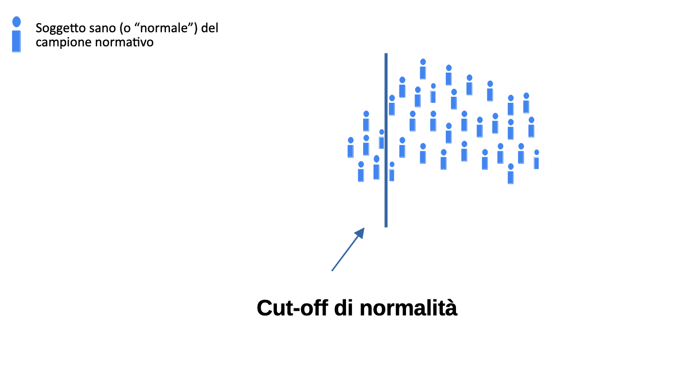{width="80%" fig-align="center"}

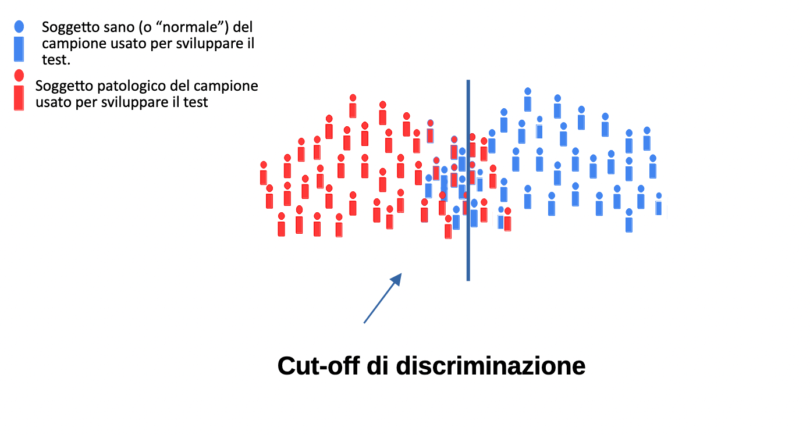{width="80%" fig-align="center"}

Nel caso di una nuova valutazione lo scopo è capire quale sia la classificazione più verosimile di una
persona di cui **non sappiamo** se sia sana o patologica (o con la condizione di interesse).

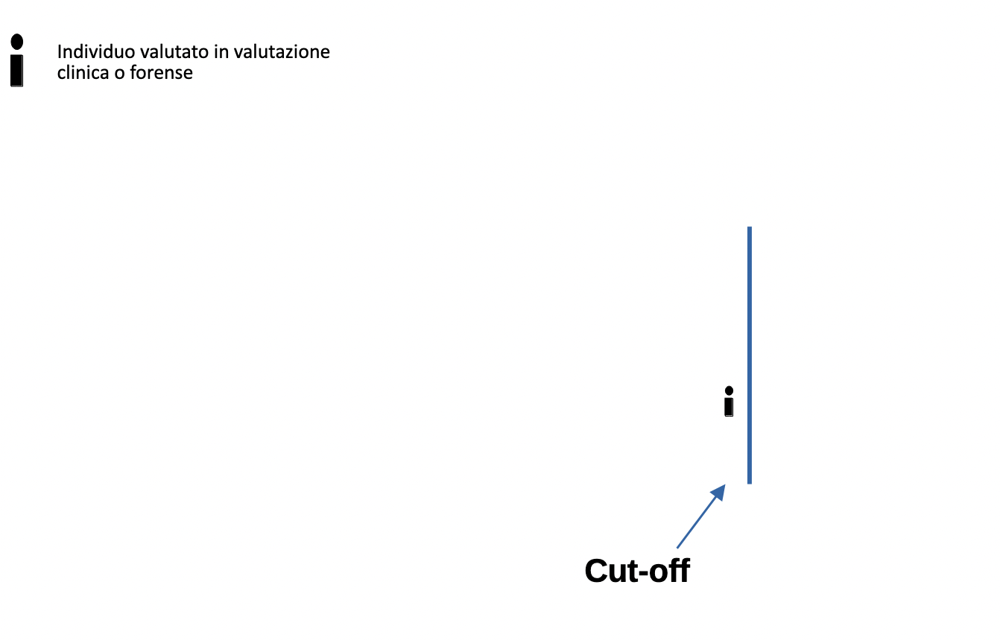{width="80%" fig-align="center"}

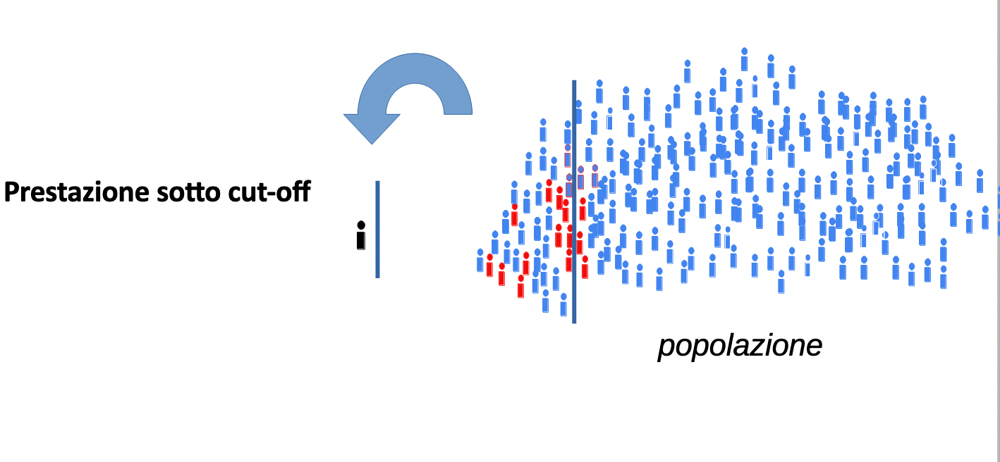{width="80%" fig-align="center"}

{width="80%" fig-align="center"}

Questa differenza è proprio quella catturata da PPV, NPV e teorema di Bayes. C'è però un'ulteriore
complicazione: le informazioni sul contesto possono cambiare l'ipotetica "popolazione" da cui la
persona è estratta. È una persona con sospetta demenza? Ha avuto un trauma cranico? È la terza volta
che viene valutata? I dati di prevalenza assumono che la persona sia estratta a caso dalla popolazione
generale, ma nella realtà questo non avviene.

# PPV e NPV in ambito forense

Ricordiamo che sensibilità e specificità esprimono stime di probabilità ben precise: la probabilità di
essere sotto soglia *assumendo che l'individuo sia davvero positivo* (sensibilità) e quella di essere
sopra soglia *assumendo che sia davvero negativo* (specificità). Ragionare con le formule, e non solo
con l'intuito, aiuta a non confonderle con altro.

In ambito forense molti test *per identificare i simulatori* riportano i valori di PPV per diversi
valori di prevalenza. Questo permette di esplorare scenari realistici e vedere come si classifica la
persona valutata. È un approccio sensato, ma assume che i valori di prevalenza esplorati siano
adeguati. Può comunque fornire informazioni importanti: per esempio, che qualunque sia la prevalenza
considerata le conclusioni non cambiano molto (per esempio, che la persona è verosimilmente un
simulatore).

::: {#fig-mathias layout-ncol=2}
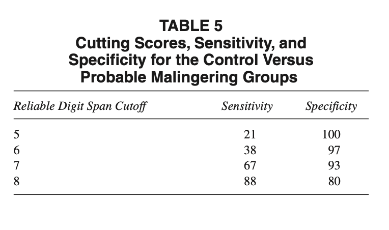{width="95%"}

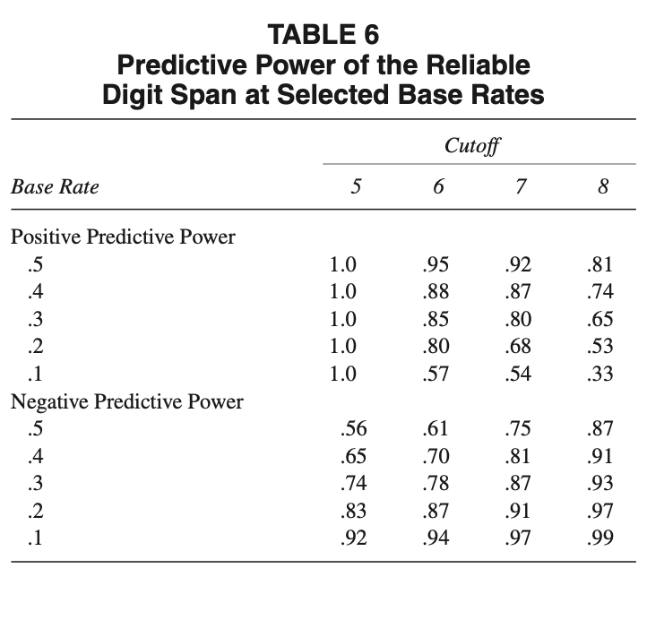{width="95%"}

Accuratezza diagnostica del Reliable Digit Span nel trauma cranico [@mathias2002detecting].
:::

Nell'esempio di @mathias2002detecting un cut-off di 5 ha un PPV pari a 1 per tutta una serie di
prevalenze realistiche secondo la letteratura: le persone positive al test sono verosimilmente
positive. Come si vede nella tabella a sinistra, questo dipende dalla specificità del 100% a quel
cut-off, a fronte però di una sensibilità bassa (21%).

## Da non dimenticare

Queste considerazioni, come quelle su sensibilità e specificità, si applicano al gruppo e al test, mai
alla specifica misurazione. Sono probabilità riferite al test (sensibilità e specificità) o al test in
combinazione con il contesto (PPV e NPV). Per la singola persona, a meno che non si voglia prevedere
qualcosa che avverrà in futuro (per esempio la probabilità di sviluppare l'Alzheimer entro un anno),
c'è una verità: o ha la condizione, o non ce l'ha. Le probabilità riguardano la capacità del test di
essere corretto, valutata quando è stato sviluppato e immaginandone un uso ripetuto, **non** la
correttezza dell'informazione nella specifica misurazione.

# Notazione probabilistica e un rischio di interpretazione

Fissato un cut-off di discriminazione $y$, sensibilità e specificità si possono scrivere come
probabilità condizionate, che sono funzioni della soglia scelta:

$$
\text{Sensibilità}(y) = P(o < y \mid C)
\qquad\qquad
\text{Specificità}(y) = P(o \geq y \mid NC)
$$

dove $y$ è il cut-off di discriminazione, $o$ il punteggio osservato, $C$ l'appartenenza al gruppo con
la condizione di interesse (per esempio la patologia) e $NC$ l'appartenenza al gruppo senza la
condizione (per esempio i sani).

A differenza del cut-off di normalità, qui le probabilità non *definiscono* la soglia: è la soglia,
scelta per esempio con la curva ROC, a determinare sensibilità e specificità. Il cut-off di normalità
$x$, definito da $P(o < x \mid N) \leq k$, garantisce invece una specificità rispetto ai sani
$P(o \geq x \mid N) \geq 1 - k$ (per esempio almeno il 95%).

Il confronto tra sensibilità e PPV (si vedano anche le simulazioni del codice allegato) mostra come
l'intuizione possa portare a errori. Sarebbe spontaneo interpretare la sensibilità come se indicasse

$$
P(C \mid o < y)
$$

mentre in realtà indica

$$
P(o < y \mid C)
$$

Le due probabilità sono diverse. $P(C \mid o < y)$ è invece quella stimata dal PPV, a condizione che
la proporzione tra $C$ e $NC$ rifletta quella reale. Come promemoria del teorema di Bayes: la
probabilità di essere laureati se si è psicologi non è la stessa di essere psicologi se si è laureati!

# Considerazioni conclusive

Anche per i test basati su condizioni di interesse vorremmo, idealmente, che il gruppo dei sani e
quello dei pazienti fossero composti da persone il più possibile *simili* all'individuo da valutare:
solo così il punteggio atteso, sia nello scenario in cui la persona ha la condizione sia in quello in
cui non ce l'ha, è davvero informativo. Esistono anche metodi che calcolano curve ROC includendo
covariate, cioè altre variabili che possono influenzare la soglia e quindi sensibilità e specificità,
in modo del tutto analogo ai metodi di regressione per i cut-off di normalità. Questi metodi però non
sono praticamente mai stati usati in neuropsicologia clinica e forense, e non li approfondiamo.

Per l'identificazione di condizioni di interesse valgono molte delle considerazioni già fatte per
deficit e peggioramento. Sensibilità, specificità, PPV e le altre misure sono tanto più precise quanto
più ampio è il campione, perché un campione ampio è più rappresentativo della popolazione. Il
cut-off di discriminazione ottenuto nel campione potrebbe essere diverso da quello della popolazione
(che è quello che ci interessa), e quanto più grande è il campione tanto più possiamo essere sicuri che
i due siano simili. Per questo è sempre meglio interpretare questi valori integrandoli con altre
informazioni.

Nei test con condizione di interesse, inoltre, spesso non sono disponibili cut-off che tengano conto
di variabili come età, scolarità o sesso, perché i metodi più usati per le analisi ROC non le
considerano. Valgono quindi tutti i limiti legati alla rappresentatività del campione, di cui tenere
conto nell'interpretazione. Ogni altra considerazione resta valida: per esempio, sono preferibili
norme specifiche per il paese e norme recenti.

# In sintesi {.unnumbered}

Quando esiste un gold standard si può passare dal cut-off di normalità, definito solo dai sani, a un
cut-off di discriminazione, scelto confrontando le distribuzioni dei due gruppi. Sensibilità e
specificità descrivono il test assumendo di conoscere la condizione della persona; la curva ROC ne
mostra il compromesso al variare della soglia, e una soglia adeguata potrebbe anche non esistere. Ciò
che vorremmo sapere, la probabilità di avere la condizione dato un punteggio sotto soglia, dipende
anche dalla prevalenza nel contesto della valutazione, come mostrano il teorema di Bayes e il PPV.
Tutte queste probabilità si riferiscono al test e al contesto, non alla singola misurazione.

# Riferimenti {.unnumbered}

::: {#refs}
:::
