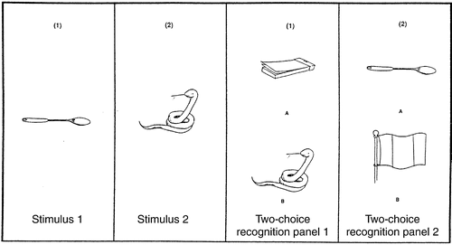
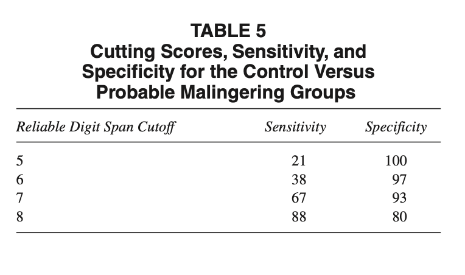
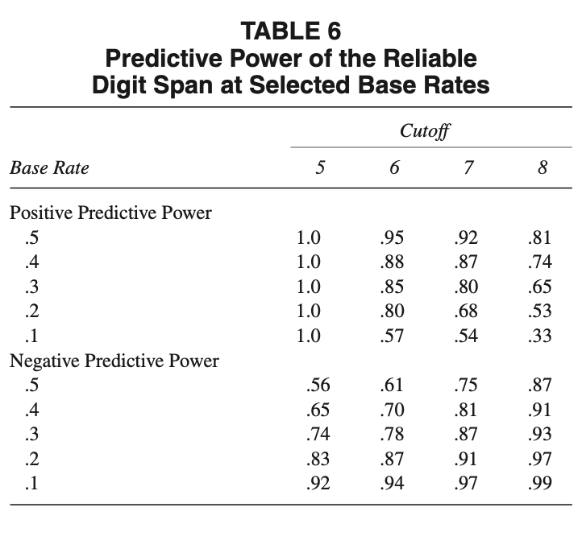

::: {.callout-note}
## Nota sull'uso dell'intelligenza artificiale

Questo handout è stato generato con l'assistenza di **Claude** (Anthropic), un modello di
intelligenza artificiale, a partire dalle slide della lezione 6 (*Simulazione e validità di
performance*) e usando come riferimento il libro del corso, *Oltre i punteggi* [@arcara2025oip]. Al
modello è stato chiesto di riscrivere in forma discorsiva il contenuto delle slide, integrandone le
figure, **senza aggiungere nuovo materiale**. Il testo può comunque contenere imprecisioni: in caso di
dubbio fanno fede le slide, il libro e quanto detto a lezione.

Materiale distribuito con licenza Creative Commons Attribuzione – Non commerciale 4.0 Internazionale
(CC BY-NC 4.0, <https://creativecommons.org/licenses/by-nc/4.0/deed.it>).
:::

# La validità di performance

Negli studi di neuropsicologia forense si parla spesso di **validità di performance** per stabilire
se una specifica valutazione sia da considerare valida. Vale la pena notare una differenza rispetto a
quanto visto finora: nelle lezioni precedenti abbiamo parlato di validità come di una proprietà dei
*test*, mentre la validità di performance è una proprietà della *valutazione*. La domanda che ci si
pone è:

> *In questa specifica istanza di misurazione, sto valutando ciò che intendo valutare?*

## Performance Validity Testing

Esistono strumenti, pratici e concettuali, per stabilire se una performance sia da considerarsi
valida. Queste procedure sono note come **Performance Validity Test (PVT)**. I test che le usano sono
anche chiamati **Effort Test** (test dello sforzo), perché indagano se la persona esaminata si stia
"sforzando a sufficienza".

Ricordiamo infatti che i test cognitivi sono test di *performance massima* (si veda la lezione 2,
*Cornice teorica*): perché il punteggio rifletta le capacità della persona, questa deve dare il
meglio di sé. Basta impegnarsi di meno, o "sforzarsi di meno", per invalidare il risultato del test.

{width="65%" fig-align="center"}

## Una nota sulla simulazione

Considerare la simulazione come una condizione sì/no (o si sta simulando o non si sta simulando) è
probabilmente una semplificazione [@nies1994neuropsychological]. È più ragionevole pensare che la
performance possa collocarsi lungo un *continuum* che va dalla performance genuina a quella con
simulazione. Entrano inoltre in gioco altri aspetti, per esempio aspetti psicologici inconsci, che
potrebbero portare a prestazioni deficitarie in assenza di un deficit cognitivo o di un danno.

Si tratta di aspetti molto importanti, ma più teorici: qui non li approfondiremo e ci concentreremo
sugli aspetti statistici.

## Definizioni

Alcuni concetti, strettamente legati tra loro, torneranno spesso nel seguito.

::: {.callout-tip}
## Definizione: malingering, SVA e PVT

**Malingering (simulazione)**: la produzione intenzionale di problemi fisici o psicologici falsi o
grossolanamente esagerati. La motivazione è solitamente esterna: per esempio evitare il servizio
militare o il lavoro, ottenere un compenso finanziario, eludere un'azione penale o procurarsi
farmaci.

**Symptom Validity Assessment (SVA)**: l'insieme di tecniche (interviste, test, raccolta di
evidenze) per valutare la credibilità dei sintomi, cognitivi e fisici, manifestati da un individuo.

**Performance Validity Testing (PVT)**: l'insieme di tecniche statistiche e metodologiche per
assicurarsi che la persona stia affrontando in maniera adeguata la situazione di valutazione (sforzo
adeguato, motivazione adeguata).
:::

# Come identificare un simulatore

Come principio generale, si costruiscono test in modo tale che la performance stessa mostri che è
probabile che la persona stia mentendo. Le strategie principali sono tre:

1. **Pattern di risposte inverosimili anche rispondendo in maniera casuale.** Si usano in test a
   scelta forzata, verificando se la performance osservata è poco probabile anche ipotizzando
   risposte del tutto casuali, il che suggerisce una menzogna intenzionale.
2. **Test molto facili persino per pazienti deteriorati.** Si usano valori normativi ottenuti da
   popolazioni cliniche, per mostrare che persino in popolazioni cliniche molto gravi la performance
   attesa non è così bassa.
3. **Test sviluppati per distinguere tra gruppi noti.** Si usano gruppi di persone a cui è stato
   chiesto esplicitamente di fingere un deficit, così da avere una condizione di interesse di
   "simulazione". Queste persone possono essere sane oppure appartenere a una categoria target (per
   esempio popolazioni psichiatriche). Questa strategia è legata al concetto di *validità di
   criterio* (o *validità di gruppi noti*, *known-group validity*).

Le sezioni che seguono le descrivono una per una.

# Strategia 1: risposte inverosimili anche rispondendo a caso

L'idea si può formalizzare così:

$$
\text{si trovi } x \text{ tale che } P(o < x \mid R) \leq k_s
$$

dove $o$ è il punteggio osservato, $R$ indica che la persona sta rispondendo in modo casuale
(*random*) e $k_s$ è una soglia di probabilità molto piccola (in genere il solito 5%). La strategia
si può applicare solo ai test a scelta forzata (per esempio: "l'immagine giusta è quella a destra o
quella a sinistra?"). In questo caso si calcola la probabilità di ottenere il pattern osservato se la
scelta fosse casuale, cioè con il 50% di probabilità per ciascuna alternativa.

## Il Test of Memory Malingering (TOMM)

Il **Test of Memory Malingering** (TOMM) è il test più comune basato su questa strategia. Il suo
assunto è molto semplice: con una scelta a due alternative è molto facile modellare la probabilità di
ottenere un certo numero di risposte corrette rispondendo a caso.

Il test consiste di due fasi. Nella fase di studio si presentano degli item da ricordare (nella
versione originale del TOMM questa fase viene ripetuta due volte). Nella fase di test, ciascun item
presentato nella fase di studio viene mostrato in coppia con un distrattore, e l'esaminato deve
indicare quale dei due aveva visto in precedenza.

{width="70%" fig-align="center"}

Un simulatore tenderà a indicare volontariamente l'immagine sbagliata più spesso di quanto
accadrebbe per caso. Ma così facendo rivela, di fatto, di aver riconosciuto quale fosse l'immagine
giusta.

Con risposte a scelta forzata è semplice modellare la probabilità attesa di un certo pattern di
risposte, dato un certo numero di prove, usando come riferimento la **distribuzione binomiale**. Per
esempio, su 50 item, assumendo che rispondendo a caso ci sia il 50% di probabilità di scegliere
l'item corretto, la probabilità di rispondere correttamente a meno di 19 item è inferiore al 5%.
Un punteggio così basso è quindi poco verosimile anche per chi risponde in modo del tutto casuale
(si veda il codice allegato alla lezione per un esempio).

## Vantaggi e svantaggi

**Vantaggi.** Il TOMM è un test molto semplice e di fatto non richiede dati normativi: basta
modellare la probabilità di risposte casuali. Si è inoltre mostrato molto efficace anche
nell'identificare simulatori definiti tramite altre procedure, con buona sensibilità e specificità
(si veda anche la strategia 3).

**Svantaggi.** Chi conosce o intuisce come funziona il TOMM può aggirarlo facilmente, rispondendo in
modo misto o corretto e poi andando male in altri test. Inoltre, una persona potrebbe essere
preparata dai propri consulenti a rispondere a test di questo tipo.

# Strategia 2: test molto facili anche per pazienti gravi

In questo caso la formalizzazione è analoga alla precedente:

$$
\text{si trovi } x \text{ tale che } P(o < x \mid D) \leq k_s
$$

dove $k_s$ è una probabilità molto piccola (per esempio il 5%) e $D$ indica i pazienti molto
deteriorati. In altre parole, si cerca un punteggio che persino pazienti molto gravi raramente
ottengono.

## Il Word Memory Test

Il **Word Memory Test** (WMT) è un test di memoria per coppie di parole [@green1999detecting],
diviso in più fasi:

- nella prima fase si presentano 20 coppie di parole (per esempio cane/gatto, pesce/pinna), ciascuna
  per 6 secondi sullo schermo, e la presentazione viene ripetuta due volte;
- subito dopo si presentano 40 coppie, in cui una sola parola era presente in origine e l'altra è un
  distrattore (per esempio cane/coniglio, gatto/topo);
- dopo 30 minuti, senza che fosse stato annunciato, si presentano altre 40 coppie con altri 40
  distrattori (per esempio cane/ratto).

Spesso in questi test, come in ogni test per la simulazione, si sottolinea che il compito è
difficile, per indurre la persona a credere che chi ha un deficit avrebbe una performance bassa
(quando in realtà non è vero).

## Vantaggi e svantaggi

**Vantaggi.** È relativamente facile ottenere cut-off in questo modo.

**Svantaggi.** La strategia soffre dello stesso problema di tutti i cut-off di normalità: si fa un
ragionamento inverso, e non si ha una sensibilità o una specificità nell'identificare un *vero
simulatore* (si veda l'handout della lezione 5). Per questo praticamente tutti i test, incluso il
WMT, sono sviluppati anche ricorrendo alla validità di criterio, cioè alla strategia descritta nella
prossima sezione.

# Strategia 3: test sviluppati per distinguere tra gruppi noti

Molti test per identificare simulatori in ambito forense seguono i principi per distinguere tra
gruppi stabiliti a priori (si vedano la validità di criterio o di gruppi noti, e la lezione 5 sulle
condizioni di interesse). In questo caso la condizione di interesse è *essere verosimilmente un
simulatore*, e sensibilità e specificità si scrivono come:

$$
\text{Sensibilità} = P(o < y \mid S)
\qquad\qquad
\text{Specificità} = P(o \geq y \mid NS)
$$

dove $y$ è il cut-off di discriminazione, $S$ indica l'essere un simulatore secondo il gold standard
e $NS$ l'essere un non simulatore secondo il gold standard.

## Come definire un "simulatore"?

Il punto delicato è proprio il gold standard: come si stabilisce chi è un simulatore? Le soluzioni
principali sono tre.

1. **Simulatori su richiesta.** Si chiede a persone sane di simulare (a volte con un incentivo
   economico in caso di successo, per aumentare il realismo) e le si confronta con altre persone sane
   o con pazienti per cui è inverosimile che simulino.
2. **Classificazione tramite altri PVT.** Si stabilisce la presenza della condizione di interesse
   (simulatori vs non simulatori) applicando altri strumenti di PVT, anche in combinazione. In questo
   caso il risultato agli altri strumenti diventa il gold standard.
3. **Gruppi con simulazione molto verosimile** (*probable malingering*). Si usano gruppi patologici
   per cui c'è già un forte sospetto di simulazione, confrontandoli con altri in cui questo sospetto
   non c'è. Un esempio classico è il confronto tra pazienti che stanno facendo riabilitazione (bassa
   probabilità di essere simulatori) e pazienti che hanno chiesto una valutazione per riscuotere
   un'assicurazione e che lamentano deficit cognitivi molto gravi a fronte di un funzionamento
   quotidiano apparentemente alto (alta probabilità di essere simulatori). In questo caso
   l'appartenenza a un gruppo secondo questi criteri è considerata la *ground truth*.

::: {.callout-note}
## Attività: uno spunto di riflessione

Immaginate un esperimento per sviluppare un test cognitivo che identifichi i simulatori. Sono
arruolati studenti universitari: a metà viene chiesto di simulare, all'altra metà di non simulare.
Quali sono i possibili problemi e limiti di questo approccio? E come potrebbero essere risolti?
:::

## La definizione di "verosimile simulatore"

Per la terza soluzione, @slick1999diagnostic hanno proposto dei criteri per identificare diversi
livelli di probabilità di simulazione (certa, probabile, possibile) sulla base della presenza di uno o
più dei seguenti criteri:

> *In determining the presence of MND (Malingered Neurocognitive Dysfunction), the case must be
> evaluated on the basis of four criteria: (A) presence of substantial external incentive, (B)
> evidence from neuropsychological testing, (C) evidence from self-report, and (D) behaviors meeting
> the necessary B and C criteria are not fully accounted for by psychiatric, neurological, or
> developmental factors. All diagnoses of malingering require the presence of an external incentive
> (Criterion A).*

In sintesi, per valutare la presenza di una disfunzione neurocognitiva simulata si considerano: (A)
la presenza di un incentivo esterno sostanziale; (B) evidenze dai test neuropsicologici; (C)
evidenze dall'auto-resoconto della persona; (D) il fatto che i comportamenti che soddisfano i
criteri B e C non siano pienamente spiegati da fattori psichiatrici, neurologici o dello sviluppo.
Ogni diagnosi di simulazione richiede la presenza di un incentivo esterno (criterio A).

## Il Reliable Digit Span

Il **Reliable Digit Span** (RDS) è la somma delle sequenze più lunghe ripetute correttamente in entrambe
le prove, nel Digit Span avanti e nel Digit Span indietro. La sua
utilità in ambito forense si basa sul fatto che le persone possono sovrastimare la difficoltà di
questo test e ottenere quindi una performance molto (troppo) bassa. Spesso però se ne riporta la
capacità di distinguere tra gruppi di pazienti.

::: {#fig-rds layout-ncol=2}
{width="95%"}

{width="95%"}

Accuratezza diagnostica del Reliable Digit Span nel distinguere controlli e gruppo con probabile simulazione, in pazienti con trauma cranico [@mathias2002detecting].
:::

Ricordiamo che il **valore predittivo positivo** (*Positive Predictive Power* o *Value*, PPV) indica
quale percentuale delle persone positive al test sarà effettivamente un simulatore. Questo dipende da
quanti simulatori ci aspettiamo nella popolazione valutata, cioè dalla prevalenza (*base rate*);
avere questi valori per diversi scenari può aiutare molto nell'interpretazione dei risultati.

Per esempio, se una persona ottiene un punteggio inferiore a 5, potremmo dire: "anche ipotizzando un
base rate basso, pari a .1 (cioè il 10% di simulatori nella popolazione), con un cut-off di 5 il PPV
è pari a 1.0 (e il NPV a .92)". Come si vede nella tabella di sinistra, questo risultato dipende
dalla specificità del 100% a quel cut-off, a fronte però di una sensibilità bassa (21%).

## Vantaggi e svantaggi

**Vantaggi.** I test sviluppati in questo modo forniscono valori di sensibilità, specificità, PPV e
NPV che aiutano molto nell'interpretazione dei risultati.

**Svantaggi.** Il limite principale è l'adeguatezza del gruppo dei "simulatori". In alcuni casi si
assume che siano simulatori sulla base di altri test. Quando invece si chiede esplicitamente di
simulare, la scelta può essere poco ecologica: nella simulazione legata allo sviluppo del test la
posta in gioco è inevitabilmente più bassa. Uno studente che vince 10 € in più se finge bene non può
essere paragonato a un paziente che finge un deficit per ottenere un risarcimento maggiore
dall'assicurazione.

# Altri strumenti: lo Structured Inventory of Malingered Symptomatology (SIMS)

Esistono anche strumenti per identificare simulatori che non sono test di performance massima. Un
esempio è lo **Structured Inventory of Malingered Symptomatology** (SIMS), un questionario con
risposte sì/no. Gli item sono raggruppati in scale che aiutano a identificare la simulazione di
disabilità intellettive, di disturbi fisici o di disturbi psichiatrici; si ottiene inoltre un
punteggio totale.

Si considerino questi due item:

- *Negli ultimi giorni faccio fatica a dormire* — SÌ/NO
- *La mia memoria è talmente peggiorata che per alcuni giorni non riesco a ricordare nulla* — SÌ/NO

Qual è la differenza tra i due? Il primo descrive un sintomo plausibile e comune. Il secondo, invece,
descrive un sintomo "impossibile": è proprio questa la caratteristica di alcuni item del SIMS.

Nello studio originale il SIMS ha mostrato evidenze di validità nel distinguere tra gruppi noti,
usando diversi gruppi di partecipanti a cui era chiesto di fingere deficit specifici (per esempio
psichiatrici o cognitivi), con valori elevati di sensibilità e specificità [@smith1997detection].

![Sensibilità, specificità ed efficienza delle singole scale del SIMS nello studio originale [@smith1997detection].](../Figures/SIMS.png){width="85%" fig-align="center"}

# Considerazioni conclusive

L'identificazione dei simulatori si basa sugli stessi principi statistici usati per identificare un
deficit, un peggioramento o altre condizioni di interesse (per esempio una patologia). In questo
caso, però, il test è spesso costruito in modo da indurre chi è in malafede a produrre un pattern di
risposte improbabile, che un paziente con un deficit reale, anche grave, non produrrebbe.

Molto spesso i test per la simulazione riportano sensibilità e specificità nell'identificare i
simulatori, e anche PPV e NPV secondo vari scenari di prevalenza. Il tema resta complesso anche
perché, a fini statistici, si usa spesso la distinzione netta simulazione/non simulazione, quando è
verosimile che esistano diversi gradi di simulazione.

Anche per i test specifici per la simulazione valgono le considerazioni fatte per ogni altro aspetto
statistico. Sono preferibili campioni ampi, che forniscono stime più solide dei cut-off perché più
rappresentativi della popolazione. Restano inoltre i limiti del confronto con un singolo campione
normativo, che potrebbe non essere adeguato ai nostri scopi (per esempio per età o scolarità):
l'ideale sarebbe disporre sempre di persone il più possibile *simili* all'individuo da valutare. Ogni
altra considerazione rimane pertinente: per esempio, sono preferibili norme specifiche per il paese e
norme recenti.

# In sintesi {.unnumbered}

La validità di performance riguarda la singola valutazione, non il test: un punteggio ottenuto senza
un impegno adeguato non misura ciò che il test intende misurare. Per identificare una possibile
simulazione si usano tre strategie: pattern di risposte improbabili anche rispondendo a caso (come
nel TOMM, con la distribuzione binomiale), test così facili che persino pazienti gravi raramente
falliscono (come il WMT), e test validati su gruppi noti (come il Reliable Digit Span), che
forniscono sensibilità, specificità, PPV e NPV. Il punto critico di quest'ultima strategia è come si
definisce il gruppo dei "simulatori". Valgono infine tutte le cautele già viste: la simulazione è
probabilmente un continuum più che una dicotomia, e le stime dipendono dall'ampiezza e dalla
somiglianza del campione rispetto alla persona valutata.

# Riferimenti {.unnumbered}

::: {#refs}
:::
